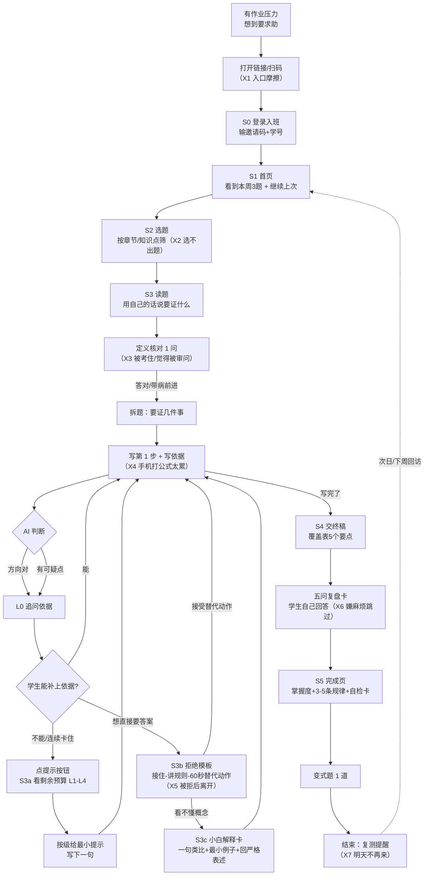

# 01 学生真实使用流程调研

> 版本 v1 ｜ 2026-10-31 ｜ 作者：调研员 ｜ 依赖：[`../00-过程记录/02-流程与页面契约.md`](../00-过程记录/02-流程与页面契约.md)（下称「契约」，单一事实源）
> 读者：产品负责人、产品设计、原型开发、技术方案。假设读者**不是数学专业**，出现的数学词第一次都配一句白话解释。
> 本文件回答三个问题：**学生到底在什么情境下用、一次完整使用长什么样、中间会在哪里跑掉。**

---

## 0. 一页纸结论（先看这 6 条）

1. **学生不是「不会做」，是「不知道下一步写什么」。** 他最需要的不是讲解，而是一个能把他从空白页推出去的最小动作——这正好对应契约 S3 的 L0 追问（只问依据、不给信息）。
2. **求助是有心理成本的。** 问同学怕丢脸、问老师怕被 judge、搜题 App 给了答案但抄完更慌。产品要做的是**降低「开口」的门槛**，而不是降低题目的门槛（对应 S3 第一条消息的情绪承接、S3b 拒绝模板）。
3. **一次典型使用只有 20–25 分钟、在晚上 21:00–23:30、在宿舍床上用手机。** 动线里任何超过 3 步的注册、任何需要打长公式的输入，都会把人劝退（对应 S0 演示模式、S3 草稿区）。
4. **最大的流失点不在「不会做」，而在三个瞬间：一打开不知道从哪开始、卡住后连续被追问像被审问、点击「给我答案」被拒绝后觉得这产品没用。** 这三处必须在原型里看得见（S1、S3、S3b）。
5. **「独立完成」是教师端最值钱的指标，但绝对不能变成对学生的惩罚。** 只要学生发现「用了提示会被记账」，他就会绕过系统去搜题——数据反而更假（对应契约 §8 字段与 S6 看板）。
6. **竞品的默认目标是「让学生这道题做出来」，我们的目标是「让学生下次自己做出来」。** 一句话差异化：**别人给你答案，我们只把你卡住的那一步指出来。**

---

## 1. 调研方法与证据等级（先说清楚这份材料有多硬）

本轮**无法直接访谈学生**（没有学生样本、不能进班观察），所以本文件是「二手证据 + 竞品体验推断 + 学习科学文献」的三角拼图，不是问卷统计。每一条都标证据等级：

| 等级 | 含义 | 本文件中的典型来源 |
|---|---|---|
| **A 已核实** | 我打开过源码/网页原文并核对 | 调研员本轮读取的仓库源码、App Store 页面、ACL 论文页 |
| **B 二手** | 检索到摘要/项目自述，未读全文 | 产品评测、百科、论文摘要 |
| **C 推断待验证** | 基于教学常识与文献的合理推断 | 场景细节、流失点排序 |

> 所有 **C 级推断** 在 §8 汇总成「待验证清单」，交给罗老师访谈或下一步学生小样本测试去证实/推翻。**不要把 C 当结论写进对外材料。**

---

## 2. 学生画像：三类人，三种使用动机

| 画像 | 成绩区间（约） | 用产品的动机 | 最怕的东西 | 对产品的要求 |
|---|---|---|---|---|
| **小陈 · 跟上课堂型（大一）** | 60–75 | 作业要交、不想挂科；课前想预习但看不懂书 | 被同学看到自己不会；被老师觉得自己笨 | 门槛低、能量小、有任务清单、能交作业 |
| **小林 · 中游想提升型（大二）** | 75–88 | 想搞懂证明题套路，考研/保研有压力 | 花了时间还是不会；被 AI 敷衍 | 提示要真的有用、能看到自己进步 |
| **小周 · 冲刺/重修型（大二/考研）** | 85+ 或已挂科 | 补短板、刷题型、需要确定性 | 浪费时间在已经会的题上 | 选题精准、可跳过、进度可追踪 |

> 契约里的「学生」主要是**小陈和小林**。小周是考研复习生，本轮原型覆盖，但不是主场景。**这三类人不要用同一套默认引导强度**——这是后续「掌握度自适应」的产品依据（本轮不做，只留字段）。

---

## 3. 五个真实使用场景（逐场景拆）

> 每个场景都按同一模板写：**人在哪、想干什么、什么感觉、卡在哪、现在怎么办、希望产品怎么帮**。场景 1–4 是任务要求的必选，场景 5 是补充的真实高频情境。

### 场景 1｜课前预习：明天要讲「级数收敛」，今晚想先看懂

| 项 | 内容 |
|---|---|
| **人物** | 小陈，大一，数学分析（上）第 11 章 |
| **时间地点设备** | 周日 20:30–21:30，宿舍床上，**手机**，戴耳机（怕吵室友），隔壁有人在打游戏 |
| **目标** | 不是做题，是「明天上课别一脸懵」；想知道「收敛这个词到底在说什么」 |
| **情绪** | 焦虑 + 心虚。打开教材看到 ε–N（白话：用「任意小的误差」和「从某一项之后」来描述「越来越接近」的一套写法）就困，觉得自己不是学数学的料 |
| **卡点（数学）** | 定义里的量词顺序（「对任意 ε，存在 N」和反过来差在哪）、为什么证明要分奇偶/要写不等式 |
| **卡点（产品）** | **不知道该点哪里**；教材看不懂，视频太长（40 分钟），没有「5 分钟版」 |
| **现有替代方案** | ① 翻教材（看 10 分钟睡着）② B 站搜「级数收敛 速成」（讲得爽但不会做题）③ 问室友（室友也在打游戏）④ 直接问通用 AI（豆包/DeepSeek）：得到一大段完整讲解，看懂了，**但第二天做题还是不会** |
| **期望帮助** | 「先用一句话告诉我这章在干嘛，再给我一道最小的小题让我试试手感」 |
| **对设计的要求** | 预习场景**不该走完整 16 轮证明流程**。契约 S1 首页的「今日任务」可以承载「3 分钟概念热身 + 1 道对应小题」，但**要点进 S3 才有真引导**。→ 建议：S1 增加「预习模式」入口（本轮可作为 S1 的一个任务卡片，不新增页面）。**P1** |

> 白话锚点：**级数收敛** = 一列数一直加下去，加出来的和会不会稳定停在某个数附近；**条件收敛** = 加起来有和，但如果把每项取绝对值再加就爆掉；**绝对收敛** = 取绝对值再加也有和。契约 §7 的演示题（∑(−1)^(n−1)/√n）问的就是「是哪种收敛」。

### 场景 2｜写作业卡住（**核心场景**）

| 项 | 内容 |
|---|---|
| **人物** | 小林，大二，周六下午写第 6 周作业，第 3 题（证明某级数条件收敛） |
| **时间地点设备** | 周六 15:00–17:00，图书馆/自习室，**笔记本电脑 + 草稿纸**；作业周日 23:59 截止 |
| **目标** | 把这道题**自己写出来**并交上；不是要答案，是「卡在第一步」 |
| **情绪** | 烦躁 → 自我怀疑 → 侥幸（想抄）。已经盯了 25 分钟，草稿纸写了三行又划掉 |
| **卡点（数学）** | ① 知道要用莱布尼茨判别法（白话：交错级数如果「一项比一项小」且「趋于 0」，就一定收敛），但**不会写「一项比一项小」的严格证明**；② 分不清「证收敛」和「证不绝对收敛」是两件事，只写了一件 |
| **卡点（产品）** | 手机搜到的答案抄不进脑子；通用 AI 一次给三段推导，**看着都对但自己复现不出来**；问同学「你第三题怎么写」→ 同学直接发答案图片 |
| **现有替代方案** | ① 问同学（快，但得到答案；且要看人脸色）② 作业帮/豆包爱学拍照搜题（**秒出解析**，抄完有负罪感，考试还是不会）③ 通用 AI（会顺着你说、会给完整证明，**违反我们红线的那部分恰恰是学生最想要的**）④ 硬扛（40 分钟后放弃，空着交） |
| **期望帮助** | 「别给我答案。告诉我**我卡的那一步**到底缺什么，我马上自己写。」 |
| **对设计的要求** | 这是契约 S3 的主战场。三个关键设计：**① 只指第一个可疑点**（不判整题）；**② L0 先追问依据、再升级**；**③ 学生要答案时给「60 秒替代动作」**（S3b），而不是一句「我不能给」。 |

### 场景 3｜考前复习：三天后期中，想查漏

| 项 | 内容 |
|---|---|
| **人物** | 小周，大二，期中前 3 天 |
| **时间地点设备** | 工作日 22:00–23:30，**手机**，教室/宿舍；时间碎片化，一次 15–20 分钟 |
| **目标** | 快速找出「我哪些题型会、哪些不会」，把错的题重做一遍 |
| **情绪** | 急躁、时间压力大；对「从头讲一遍」零耐心 |
| **卡点（数学）** | 不是单题不会，是**不知道自己哪里不会**；错题本没整理 |
| **卡点（产品）** | 从头做完整流程太慢；希望「直接给我 3 道我薄弱的题」；看到大段解释就想跳过 |
| **现有替代方案** | 刷往年卷（有答案，做完对答案）、看错题、问学霸要「重点」 |
| **期望帮助** | 「用最少时间告诉我：哪个知识点我还没掌握，然后给我 1–2 道题验证。」 |
| **对设计的要求** | 契约 S1 的「继续上次 / 复测提醒」、S5 的「掌握度 + 复习建议」正是这个场景的答案。**复习场景下提示预算应放宽还是收紧？** 建议：复习时**收紧 L3/L4**（做过一遍的题不该再给示范），只留 L0–L2，避免「复习=重看答案」。→ 作为待罗老师确认的细节，本轮按契约默认预算不变（**P1**）。 |

### 场景 4｜补考/重修：这次必须过

| 项 | 内容 |
|---|---|
| **人物** | 小陈，大一下学期补考；上学期挂了，正在重修 |
| **时间地点设备** | 晚上 21:00 后，**手机为主**（打工/上课，碎片时间）；补考在 6 周后 |
| **目标** | 拿及格；需要「可执行的计划」和「确定性」 |
| **情绪** | 羞耻感（同学都过了）+ 恐惧（再挂就麻烦）+ 急功近利（想要「必考题」） |
| **卡点（数学）** | 基础断层：连极限的定义都记不牢，做证明题无从下手；**一看到「证明」两个字就跳过** |
| **卡点（产品）** | 会问「有没有答案/必考题」；对「陪练」耐心低；如果 3 分钟内没有「我学到了」的感觉就走 |
| **现有替代方案** | 找学长要往年题+答案、B 站速成、报班（贵）、直接背答案 |
| **期望帮助** | 「告诉我这周学哪 3 个点、每个点配 2 道题、做完告诉我行不行。」 |
| **对设计的要求** | 契约 S6 教师端的「未完成名单/卡点知识点 Top5」可以帮助老师提前干预；学生端需要**极小任务单元**（一题 10 分钟以内）与**明确的「今天完成了」反馈**。→ 原型可在 S1 加一句「本周必做 3 题」的进度文案，**不改结构**（**P0 文案级**）。 |

### 场景 5（补充）｜宿舍组队 / 同学互问：社交型求助

| 项 | 内容 |
|---|---|
| **时间地点设备** | 晚上宿舍，手机，2–3 人一起写作业 |
| **行为** | 「你这题怎么写」→ 拍答案照片发群里 → 抄 |
| **真实需求** | 不是要答案，是**要一个「被允许不会」的空间**；同学之间也不好意思一直问 |
| **对设计的要求** | 产品不能假装是社交工具（契约 §9 明确不做社交/排行榜）。但可以借「**60 秒替代动作**」的设计把「想问人」变成「先自己试一个动作」。**不新增功能。** |

---

## 4. 一次典型使用的完整动线（Mermaid）

> 画的是**场景 2（写作业卡住）**的主路径，因为它是契约 S0–S5 的核心链路。节点里的「X1–X7」是 §5 的流失点编号。

**动线里被隐藏的三个事实（原型要体现）**：

1. **学生从「打开」到「写出第一步」平均要经过 6 个界面动作**，任何一步超过 10 秒都可能走。所以 S0 必须有演示模式、S1 必须能一键「继续上次」、S2 必须默认按「本周必做」排序。
2. **真正的「学习时刻」只有两个**：I→K 的「被指出问题并自己补上」，以及 N→I 的「用提示写出下一句」。原型演示脚本（契约 §7 的 10 个节点）应把这两处当成高潮。
3. **完成页不是终点**：U 的复测提醒决定「28 天后还有没有人用」，这是契约 §10 D7 前后测数据的来源。

---

## 5. 6–8 个流失点与设计机会

> 流失点 = 学生在这个时刻**大概率关掉页面/换工具**。按风险从高到低排序。

| 编号 | 时刻 | 学生心里话 | 为什么会走 | 证据 | 设计机会（可直接进原型） | 落在地契约 | 优先级 |
|---|---|---|---|---|---|---|---|
| **X1** | 打开链接，看到要输邀请码+学号 | 「又要注册？算了，我直接搜题」 | 登录 = 承诺成本；学生此刻只想解决一道题 | 学习科学：求助门槛越高，越倾向「回避求助」或转向低质替代（B） | S0 提供**演示模式/免登录试做一道题**；登录侧只保留「邀请码+学号」两项，一句话隐私说明 | S0 | **P0** |
| **X2** | 进 S2 选题 | 「这么多题，我该做哪道？」 | 选择过载；学生不知道自己的薄弱点 | 自我调节学习文献：低自我效能学生更易选择过易/过难任务（B） | 默认排序 = 老师本周布置；第二入口「按知识点」；题目卡片显示「预计 10 分钟」 | S2 | **P0** |
| **X3** | 读题后被要求先说「这题要证什么」、再答 1 个定义题 | 「我就想让你讲，你还考我？」 | 预期错位：以为是答案库，结果被反问 | 协助困境：给太多会依赖、给太少会挫败，需要**先接住情绪再提要求**（B） | 第一条消息先共情一句（「刚开始没思路很正常」），再只问 1 个问题；定义核对 ≤2 轮且**允许带病前进** | S3（P1 阶段） | **P0** |
| **X4** | 开始写第 1 步，用手机打 √n、ε | 「打公式比想题还慢」 | 输入摩擦 → 认知资源被耗尽 | teecher 仓库用拍照输入规避（A）；Proof Blocks 用拖拽选择块降摩擦（B） | 草稿区支持**分步输入 + 常用符号快捷条 + 草稿自动保存**；演示版用「点击填入示例作答」降低门槛（契约 §7 允许） | S3 草稿区 | **P0** |
| **X5** | 点了「直接给我完整证明」被拒绝 | 「不给答案你还有什么用」 | 拒绝 = 价值否定；此刻情绪最高点 | 契约 §6 三段式拒绝模板（已定）；OATutor 有「bottom-out 提示」作为最后出口（A，源码见 `HintSystem.js`/`SubHintSystem.js`） | S3b：**接住（「我理解你赶时间」）→ 说清规则（「给了你就白做了」）→ 60 秒替代动作（四选一）**；替代动作必须**真的能推进**，不是打发 | S3b | **P0** |
| **X6** | 交完终稿，被要求填五问复盘卡 + 写 3–5 条规律 | 「我都做完了还要写小作文？」 | 完成后的额外劳动，收益感知低 | 自我解释效应：让学生说「为什么」能显著提升迁移（B）；但需要**短、结构化、有模板** | 复盘卡每题**一句话、有例句、可跳过但标记**；用「填空/选择」代替自由写作；完成后立刻显示「你总结的这条规律已存入自检卡」 | S4/S5 | **P0**（卡要短） |
| **X7** | 完成页，关掉 | 「做完了，然后呢？」 | 没有回来的理由；下次还是打开搜题 App | 间隔复习/测试效应（B）；契约 §8 复测提醒 | S5 显示**复测日期 + 加入提醒按钮**；S1 显示「继续上次」；教师端能看到未完成名单（S6） | S1/S5 | **P1** |
| **X8** | 连续 3 次提示后仍卡在同一处 | 「提示也救不了我，我就是不行」 | 挫败感累积 + 归因到能力（「我笨」）而非方法 | 求助行为研究：反复失败会让学生**回避求助**并降低自我效能（B）；wheel-spinning（无效尝试空转）是已知失败模式（B） | L4 之后必须有**「软着陆」**：标记为薄弱点 + 建议「先看 3 分钟定义卡」+ 允许换题/暂停；**不能无限循环追问**；教师端收到「该生卡在该知识点」 | S3/S3a/S6 | **P0** |

> 小结：**X1、X2、X4、X5 是原型必须演示的四个「生死点」**。X3/X6 决定体验口碑，X7/X8 决定 28 天留存与教师端数据质量。

---

## 6. 用学习科学证据撑住设计（白话版）

> 每一行：**理论 → 一句白话 → 对本产品的意思 → 证据链接（证据等级）**。这些不是装饰，每一条都对应契约里的某个具体设计。

| 理论 | 一句白话 | 对我们的意思 | 证据 |
|---|---|---|---|
| **求助行为 help-seeking** | 学生不是不会求助，而是会**算成本**：会不会丢脸、会不会被说笨、要花多久。成本高于收益就不问。 | 产品要把「求助」做得**比搜题更省事**：一键、不用解释、不被评价。S3 只问 1 个问题、L0 不判对错，都是在降成本。 | Aleven, Stahl, Schworm, Fischer & Wallace (2003), *Help seeking and help design in interactive learning environments*, Review of Educational Research 73(3). DOI: 10.3102/0034654307300361（B，DOI 可核，Sage 页面有反爬） |
| **协助困境 assistance dilemma** | 给太多帮助 → 学生依赖、不动脑；给太少 → 挫败、放弃。**最优帮助量在中间，且随学生状态变化。** | 这就是 L0→L4 递进与预算（L1≤3/L2≤3/L3≤2/L4≤1）的理论依据；「每轮只推进一个认知动作」也是在控制单次帮助量。 | Koedinger & Aleven (2007), *Exploring the assistance dilemma in experiments with cognitive tutors*, Educational Psychology Review 19:239–264. DOI: 10.1007/s10648-007-9049-0（B） |
| **范例学习 worked-example effect** | 新手看**完整范例**比自己硬做更省认知资源、学得更好——但前提是「看范例」之后要过渡到「自己做」。 | 所以 L4 的「示范 1–2 行 + 立即交还」是合理的；但**不能给完整证明**，否则学生停在「看范例」阶段，不能迁移。契约 E 的 L4 与红线完全一致。 | Sweller & Cooper (1985), *The use of worked examples as a substitute for problem solving in learning algebra*, Cognition and Instruction 2(1). DOI: 10.1207/s1532690xci0201_3（B） |
| **专家逆转效应 expertise reversal** | 同一份「详细讲解」，对新手有用，对熟手反而**拖慢**。 | 同一套提示强度不能对所有学生一样：小周（冲刺型）应更快拿到 L2、少给 L0 废话；小陈（补考型）需要更多 L1 与小白解释。→ 对应契约「掌握度」字段与后续自适应。 | Kalyuga, Ayres, Chandler & Sweller (2003), *The expertise reversal effect*, Educational Psychologist 38(1). DOI: 10.1207/S15326985EP3801_4（B） |
| **自我解释 self-explanation** | 学生**对自己说清楚「为什么这一步成立」**，比再听一遍讲解更能迁移到新题。 | 契约的「每步必须写依据」「五问复盘卡」「3–5 条规律」都是自我解释的工程化。**复盘卡不是形式主义，是提分手段。** | Bisra, Liu, Nesbit, Salimi & Winne (2018), *Inducing self-explanation: A meta-analysis*, Educational Psychology Review 30:703–725. DOI: 10.1007/s10648-018-9434-4（B；DOI 页面本轮抓取异常，标待核） |
| **有效失败 productive failure** | 先让学生**自己试错**（哪怕失败），再给讲解，学习效果常优于「先讲后练」。 | 支持「先追问、后提示」的顺序：**别一上来就讲**。也支持「允许带病前进」——先做，再回来补。 | Kapur (2008), *Productive failure*, Cognition and Instruction 26(3):379–424. DOI: 10.1080/07370000802212669（B） |
| **合意困难 desirable difficulties** | 学习时**稍微难一点**（主动回忆、间隔、变式）短期更痛苦、长期更牢。 | 学生在产品里「不爽」不一定是坏事，但**难度要可控**：X8 的软着陆就是把「合意困难」和「挫败放弃」区分开。变式题（S5）是合意困难的正确用法。 | Bjork & Bjork (2011), *Making things hard on yourself, but in a good way*, in Psychology and the Real World. PDF: bjorklab.psych.ucla.edu/wp-content/uploads/sites/13/2016/04/EBjork_RBjork_2011.pdf（B，PDF 链接可核） |
| **游戏系统 gaming the system / 空转 wheel-spinning** | 学生会**为了过关而作弊式使用**系统（狂点提示、复制粘贴）；也会在不会的题上**无效空转**很久。 | 这是「独立完成」指标失真的最大来源。必须记录**提示次数、粘贴标记、拒绝次数**（契约 §8 已有字段），并在教师端区分「真卡住」与「刷提示」。 | Baker, Corbett, Koedinger & Roll (2004), *Detecting student misuse of intelligent tutoring systems*; Beck & Gong (2013), *Wheel-spinning*, IJAIED 23. DOI: 10.1007/s40593-013-0007-3（B） |

> **给产品负责人的一句话解释**：上面这些研究合起来只说了一件事——**「让学生自己挣扎着说出来」比「讲给他听」更有效，但挣扎的难度必须刚好：太难就放弃，太易就依赖。** 我们的 L0–L4 阶梯和提示预算，本质就是在调这个「刚好」。

---

## 7. 5 分钟给产品负责人讲的「流程版」（口语稿）

> 用途：会上口头汇报，或写进给甲方的口头说明。不要念文档，照着讲。

**开场（30 秒）**
「学生用我们这个产品，只有一件事跟别的产品不一样：**我们不给答案。** 不是我们不会，是我们故意不给。」

**讲一个学生的一晚（2 分钟）**
「想象小林，大二，周六下午在图书馆写数分作业。第三题卡住了，盯了 25 分钟。
他现在的三个选择是：问同学——同学直接发答案图片；搜题——秒出解析，抄完有负罪感；问通用 AI——AI 一口气给三段推导，看着都对，自己复现不出来。
他打开我们：先看到本周三道题，点第三题，用自己的话说一句『要证这个级数收敛，还要判断是条件收敛还是绝对收敛』；系统说『对，那先说说条件收敛的定义』。他答对了，开始写第一步。
写了一句『这个数列递减，因为分母变大』。系统没有说『错』，只说：**『你说递减，那 n 和 n+1 比，你能把不等式写出来吗？』** 他写出来了。
第二步卡住，他点了提示。提示不是讲解，是一句方向：『这题的关键是莱布尼茨判别法，它有三个条件，你逐条核对了吗？』他补上了。
他急了，点了『直接给我完整证明』。系统说：『我理解你赶时间，但给了你就白做了。要不这样，你先把第一步发我，我只点评这一步？』——他照做了。
最后他交终稿，系统不给他看参考答案，只给一张覆盖表：五个要点你覆盖了五个。然后让他用一句话回答五个问题。最后完成页上写：**「这题你独立完成了 70%，薄弱点：绝对收敛的判断。」**
整个过程 22 分钟，他在图书馆，用手机。」

**收尾（1 分钟）**
「所以产品其实就四步：**说清要证什么 → 一步一步写并写依据 → 卡住时按最小提示拉一把 → 写完后自己总结。**
老师那边看到的不是分数，是**他卡在哪、点了几次提示、有没有独立完成**。
一句话：**别人给你答案，我们把你卡住的那一步指出来。**」

---

## 8. 待验证清单（交给罗老师访谈 / 后续小样本测试）

| # | 待验证的 C 级推断 | 怎么验证 | 若被推翻要改什么 |
|---|---|---|---|
| V1 | 学生最常卡在「不知道下一步写什么」，而不是「不懂概念」 | 罗老师访谈 Q1–Q3；让 3–5 名学生做 1 题观察 | 若主要是概念断层，S3 前要加「定义复习卡」入口（P1） |
| V2 | 手机端输入公式是真实流失原因（X4） | 小样本测试记录「进入 S3→提交第一步」耗时与放弃率 | 若成立，P0 加公式快捷条/结构化输入；不成立则降级 P1 |
| V3 | 学生对「被追问」的耐受度低于我们的预期（X3） | 访谈老师对学生的观察 + 5 人试用 | 调整首条消息的情绪承接与 L0 频率（可能从「每轮」降为「每 2 轮」） |
| V4 | 学生「要答案」被拒后真的会走（X5） | 原型可用性测试（点「我要答案」后观察） | 若走得厉害，替代动作要更强（例如给「同类更简单题」） |
| V5 | 老师认为「独立完成」比「正确率」更重要 | 罗老师 D1/D7 | 若老师更看重正确率，S6 看板要加「平均提示轮数 vs 正确率」对照 |
| V6 | 预习/复习场景值得单独做任务卡 | 访谈 + 试点数据 | 本轮只在 S1 加文案，不新增页面 |

---

## 9. 引用与来源

**内部材料（项目根路径）**

- 流程与页面契约（单一事实源）：[`../00-过程记录/02-流程与页面契约.md`](../00-过程记录/02-流程与页面契约.md)
- 学生端六阶段与 L0–L4：`D:\DeepSeek Harness\数学分析证明题智能体\智能体回答思路设计\学生端回答方案_v1.0.md`
- 第一版/第二版/关键条件：`D:\DeepSeek Harness\数学分析证明题智能体\智能体回答思路设计\第一版.txt`、`第二版.txt`、`关键条件.txt`
- 项目源码体检（teecher 相机输入等证据）：`D:\DeepSeek Harness\数学分析证明题智能体\_research\notes\02-项目源码体检与底座调研.md`
- teecher 仓库：`D:\DeepSeek Harness\数学分析证明题智能体\_research\repos\teecher\README.md`（苏格拉底式引导、时间追踪、提示分级、挫败检测）

**外部文献（URL 均为公开入口；标注 B 者为基于摘要/二手，未逐页核全文）**

1. Aleven, V., et al. (2003). Help seeking and help design in interactive learning environments. *Review of Educational Research*, 73(3). https://doi.org/10.3102/0034654307300361
2. Koedinger, K. R., & Aleven, V. (2007). Exploring the assistance dilemma in experiments with cognitive tutors. *Educational Psychology Review*, 19, 239–264. https://doi.org/10.1007/s10648-007-9049-0
3. Sweller, J., & Cooper, G. A. (1985). The use of worked examples as a substitute for problem solving in learning algebra. *Cognition and Instruction*, 2(1). https://doi.org/10.1207/s1532690xci0201_3
4. Kalyuga, S., et al. (2003). The expertise reversal effect. *Educational Psychologist*, 38(1). https://doi.org/10.1207/S15326985EP3801_4
5. Bisra, K., et al. (2018). Inducing self-explanation: A meta-analysis. *Educational Psychology Review*, 30, 703–725. https://doi.org/10.1007/s10648-018-9434-4
6. Kapur, M. (2008). Productive failure. *Cognition and Instruction*, 26(3), 379–424. https://doi.org/10.1080/07370000802212669
7. Bjork, E. L., & Bjork, R. A. (2011). Making things hard on yourself, but in a good way. PDF: https://bjorklab.psych.ucla.edu/wp-content/uploads/sites/13/2016/04/EBjork_RBjork_2011.pdf
8. Baker, R. S., et al. (2004). Detecting student misuse of intelligent tutoring systems. https://doi.org/10.1007/978-3-540-30139-4_50
9. Beck, J. E., & Gong, Y. (2013). Wheel-spinning: Students who fail to master a skill. *IJAIED*, 23. https://doi.org/10.1007/s40593-013-0007-3

> **证据等级提醒**：以上文献的**结论方向**可信，但具体 DOI/页码请在正式引用前逐条核对（本轮仅核对了部分 DOI 入口，个别出版社有反爬）。对外材料只引用「结论」+ 文献名，不引用未核对原文的页码。
