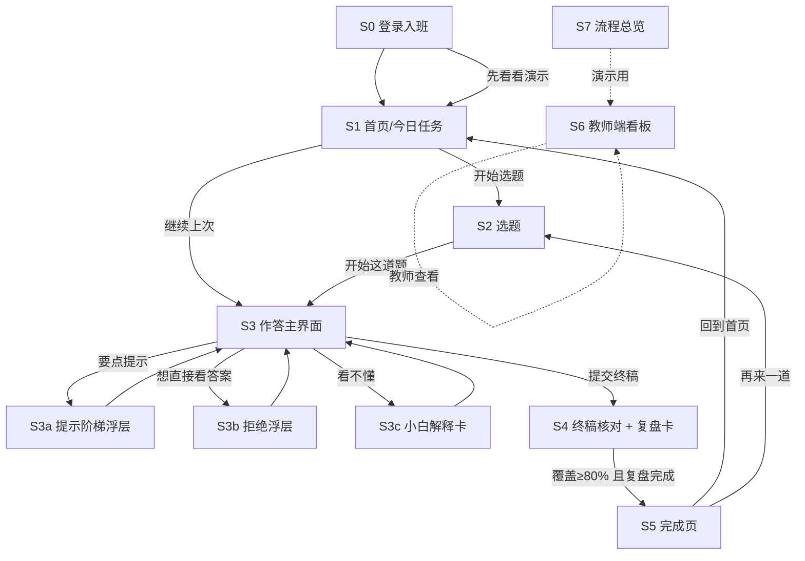

# 03-页面结构与交互规格

> 版本 v1.0 ｜ 日期 2026-10-31 ｜ 作者：产品设计（product-designer）｜ 阅读对象：原型开发、UI、技术、罗老师
> 依据：`../00-过程记录/02-流程与页面契约.md`（下称《契约》）第 5、6 节；《学生端回答方案_v1.0》第 4、7 节
> 边界：本文只写规格，**不改 05-演示原型**；页面编号严格沿用 S0–S7。

---

## 0. 一页纸

- **设计基准**：手机 375×812（iPhone SE/8 尺寸）；平板/桌面内容区居中 max-width 480px；教师端桌面 1440 双栏。
- **每屏都有「设计意图」标注**（《契约》9 节要求），便于演示时讲清「为什么这么设计」。
- **一句话贯穿全站**：不评判学生、不说教、不用「错误」二字；所有提示都是「问句」，所有放弃都有退路。
- **必须出现的红线 UI**：提示预算（还剩几次）、拒绝模板、无参考证明/无标准答案按钮。

---

## 1. 设计基准与通用规则

### 1.1 画布与断点

| 断点 | 宽度 | 规则 |
|---|---|---|
| 窄屏（主） | 320–480px | 单列；左右 16px 边距；按钮高度 ≥44px；S3 底部输入吸底 |
| 平板 | 481–1024px | 内容区 max-width 480px 居中；S3 可左右分栏（题面 4 : 互动 6） |
| 桌面 | >1024px | 学生端仍以 480px 卡片呈现（避免长行阅读累）；教师端 S6 双栏（列表 + 抽屉） |

### 1.2 通用组件与视觉语义

| 组件 | 用途 | 规则 |
|---|---|---|
| ProgressDots（阶段进度） | S3/S4/S5 顶部 6 点 | 已完成实心、当前描边、未开始灰色；旁边必须配人话文字「第 3/6 阶段 · 分步推进」 |
| TimerChip（已用时间） | S3/S4 角落 | 只显示已用时间（如「已用 06:12」），不倒数、不变红、不弹焦虑提示（C3）；教师端另存完整计时数据 |
| HintPill（提示按钮） | S3 右下悬浮 | 必须显示「还剩 N 次」，N = 9 − 已用信息型提示 |
| PrimaryBtn / GhostBtn | 主/次按钮 | 每屏最多 1 个主按钮；危险/放弃类用 GhostBtn 弱化 |
| Sheet（底部浮层） | S3a/S3b/S3c | 浮层不跳页；背景可点关闭；有明确「先不用」 |
| Toast（轻提示） | 保存、断网、复制 | 顶部 2 秒自动消失，不打断输入 |
| EmptyState | 空状态 | 一句人话 + 一个动作按钮，不用插画堆砌 |

### 1.3 文案口吻

- 用「你」，不用「您」；不出现「错误/笨/这么简单」；说「这一步的依据还差一点」而不是「你错了」。
- 数学术语第一次出现必须紧跟一句括号白话（如「条件收敛（带上正负号才收敛）」）。

---

## 2. S0 登录入班

### 2.1 布局（从上到下）

1. 品牌区：产品名「证明陪练场」+ 一句话定位。
2. 说明区：「这里不给答案，帮你把证明自己写出来。」（强调红线的第一道心理预期）
3. 表单区：邀请码输入框（6 位，大写字格）、学号输入框。
4. 主按钮「进入练习」；次按钮「先看看演示」。
5. 底部隐私说明一行 + 「为什么没有答案？」折叠说明。

### 2.2 组件与行为

| 组件 | 文案 | 行为 | 状态 |
|---|---|---|---|
| 输入框·邀请码 | 占位「6 位邀请码，比如 3F7K9Q」 | 自动转大写、去空格；满 6 位聚焦学号 | 默认/聚焦/错误（红框 + 下方一句） |
| 输入框·学号 | 占位「你的学号」 | 数字键盘 | 同上 |
| 主按钮 | 「进入练习」 | 校验通过 → S1；失败 → toast「邀请码或学号不对，请找老师确认」 | 加载中显示「正在进班…」，禁用防连点 |
| 次按钮 | 「先看看演示」 | 进入演示态 S1（预置数据，右上角标「演示数据」） | 常驻 |
| 折叠说明 | 「为什么没有答案？」 | 展开 3 行解释：给答案会让你「看懂但写不出」；这里只给你刚够的提示 | 默认收起 |

### 2.3 空/加载/错误态

- 加载：首次进入骨架屏 ≤300ms，不闪白屏。
- 错误：邀请码过期 → 「这个邀请码已过期，找老师要一个新的」；网络失败 → 「网络不太好，检查一下再试」+ 重试按钮。
- 空：不适用。

### 2.4 窄屏适配

- 320px：标题降一级字号；按钮全宽；隐私说明 2 行内。

> **设计意图**：第一次接触就建立「这里不给答案」的预期，降低后面被拒时的挫败；演示入口降低评审门槛。

---

## 3. S1 首页 / 今日任务

### 3.1 布局（从上到下）

1. 顶部问候 + 匿名昵称/学号后 4 位。
2. **本周必做**卡片：标题「本周必做 3 题」；进度条 + 文案「已完成 2 题，还剩 1 题」。
3. **继续上次**卡片：题名 + 「上次到第 3 步」+ 主按钮「继续」；无草稿时隐藏。
4. **复测提醒**卡片：日期 + 倒计时；<7 天亮色强调；可点开说明「一个月后做一道同类型题，看看还记得多少」。
5. 主按钮「开始选题」。
6. 底部轻链接「我的完成记录」（本轮原型可置灰）。

### 3.2 组件与行为

| 组件 | 文案 | 行为 |
|---|---|---|
| 必做进度条 | 「本周必做 3 题 · 已完成 2 题」 | 只读；点击进入 S2 并默认筛「必做」 |
| 继续卡片 | 「继续上次：级数的收敛性 · 第 3 步」 | 带 `resume_token` 进 S3，回到原阶段/轮次 |
| 复测提醒 | 「11 月 28 日复测」 | 打开说明浮层；无「取消」按钮 |
| 开始选题 | 「开始选题」 | S2 |

### 3.3 空/加载/错误态

- 空状态（新学生）：「这周还没有题，先从第一道开始吧」+ 「开始选题」。
- 加载：卡片骨架屏；继续卡片最后加载。
- 错误：任务数据失败 → 显示「任务没加载出来，下拉刷新试试」+ 重试。

### 3.4 窄屏

- 卡片纵向堆叠，间距 12px；复测提醒可折成一行。

> **设计意图**：学生 3 秒内知道「今天做什么」，并让「继续上次」成为最低摩擦入口。

---

## 4. S2 选题

### 4.1 布局

1. 顶部标题「选一道证明题」+ 返回 S1。
2. 筛选区：章节（横向 chips，可横滑）、知识点（下拉/二级 chips）、难度（易/中/难 三档 chips）。
3. 题目列表：卡片式，每张 = 题干前 2 行 + 标签「必做/选练」+ 知识点 + 预计 20 分钟 + 「开始这道题」。
4. 底部提示：「必做题由老师安排，选练题随意」。

### 4.2 组件与行为

| 组件 | 文案 | 行为 |
|---|---|---|
| 筛选 chips | 「级数」「极限」「微分」… | 单选章节；知识点可多选；难度单选；筛选项高亮 |
| 题目卡片 | 题干预览 2 行（超出省略） | 点卡片展开完整题面预览（本页内浮层）；按钮「开始这道题」 |
| 标签 | 「必做」「选练」 | 必做用主色描边；选练灰 |
| 开始按钮 | 「开始这道题」 | 有草稿 → 弹「上次写到第 3 步，继续还是重新开始？」；未审核题置灰「暂未开放」 |

### 4.3 空/加载/错误态

- 空：「这个筛选下没有题，换个条件试试」+ 「清除筛选」。
- 加载：列表骨架 3 张。
- 错误：题干公式渲染失败 → 显示「公式加载失败，点这里重试」，不显示乱码。

### 4.4 窄屏

- chips 横滑；卡片按钮全宽；预计用时放卡片底部一行。

> **设计意图**：选题不超过 2 次点击；「必做/选练」让老师安排与学生自选共存。

---

## 5. S3 作答主界面（核心）

### 5.1 布局（从上到下，移动端）

1. **顶部状态条**（吸顶）：返回（保存草稿确认）｜阶段进度条 + 人话「第 3/6 阶段 · 分步推进」｜角落已用时间（C3：灰字、不倒数、不弹焦虑提示）。
2. **题面区**：默认展开 4 行，可折叠为一行「查看题目」；题干下方「这题要你证什么？」提示。
3. **分步草稿区**（核心）：当前步序号「第 3 步」+ 文本框「写这一步的结论/式子」+ 第二行文本框「这一步的依据（定义/定理/上一步）」+ 主按钮「提交这一步」。
4. **AI 陪练对话区**：按轮次气泡；AI 气泡固定三段小标题（【判断】【提示】【提问】），学生气泡在右；阶段小结用分隔条 + 「小结」标签。
5. **底部操作区**（吸底）：左「要一点提示（还剩 6 次）」；右「下一步」或「提交终稿」（P3 未完成时不可提交终稿）；（弱化文字链）「我卡住了，想直接看答案」。
6. **保存状态行**：「草稿已自动保存 12:31」；断网时变黄条。

### 5.2 组件清单

| 组件 | 类型 | 关键行为/状态 |
|---|---|---|
| StageBar | 状态条 | 6 点 + 人话阶段名；点击可看「六阶段说明」浮层（不剧透做法） |
| TimerChip | 状态条角落 | 灰字显示已用时间；不倒数、不变红、不弹窗（C3）；25 分钟后仅在 AI 回复末尾轻提保存 |
| ProblemPanel | 折叠面板 | 默认展开；折叠后显示题号 + 首行 |
| StepEditor | 双输入框 + 提交 | 第一步、依据都非空才可提交（依据可点「我不知道怎么填」→ 弹 L0 追问说明）；完全空着时显示「最小起步动作」：先只写要证的结论那一句（C2，仍 L0、不占预算） |
| ChatStream | 消息列表 | AI 三段式渲染；【提问】单独高亮一行；长消息折叠 |
| HintPill | 悬浮按钮 | 显示剩余总次数；点开 S3a |
| AskAnswerLink | 弱化文字链 | 点开 S3b 拒绝浮层（不跳页） |
| SaveHint | 行内文字 | 自动保存时间；断网/恢复用 Toast |

### 5.3 S3a 提示阶梯浮层

- 标题「提示阶梯」；一张 5 行表：L0 只问依据 / L1 点一个定义 / L2 给一个方向 / L3 给一步操作 / L4 示范一两行后交还。
- 当前可用级别高亮（如「你现在可以用 L2」）；剩余次数：「L1 剩 2 · L2 剩 3 · L3 剩 2 · L4 剩 1 · 合计剩 8」。
- 「为什么升到下一级？」：列出触发条件（同一处连续 2 次没解决 / 主动求助 / 单步超过 3 分钟）。
- 按钮：「用 L2 提示」「还不够，升到 L3（需先提交一次尝试）」「先不用」。
- 约束：L3/L4 按钮在未满足触发条件时置灰 + 一行小字说明原因（不让学生觉得被耍）。
- 预算用尽时（C6）：按钮区改为软着陆三选一「看定义卡」「换一道同知识点更简单题」「转给老师」，并自动标记本题薄弱点；不再出现「再问一句」的无限追问入口。

### 5.4 S3b 拒绝浮层（要答案时）

- 结构三段（对应《契约》第 6 节）：
  1. 接住：「理解，你想快点看到完整过程。」
  2. 规则：「但给了你整份证明，你今天会了，考场上换个说法还是卡——我的作用是帮你写会。」
  3. 替代动作四选一（按钮）：「看定义原文」「二选一：先看开头，还是先看卡点」「只点评我这一步」「转给老师」。
- 底部小字：「这条规则对所有人都一样，不是针对你。」
- 行为：任一替代动作点了就关闭浮层并继续对话；连续两次拒绝时，第三次自动改「转给老师」为第一选项。

### 5.5 S3c 小白解释卡（看不懂时）

- 结构三块：①「打个比方」一句 + ②「一个最简单的例子（跟本题无关）」+ ③「回到严格说法」（定义/定理原文）。
- 底部：「用你自己的话复述一遍」输入框 + 「我复述好了」按钮。
- 顶部标签「白话解释 1/2」；超过 2 次按钮置灰：「这题的白话解释用完了，可以转给老师或换一道小一点的题」。
- 预算用尽软着陆时，S3c 退化为「定义卡」：只给严格定义/定理原文 + 一句「看懂了吗？说说你下一步要做什么」，不给类比和小例子（C6）。

### 5.6 空/加载/错误态

- 加载：题目骨架 + 「正在准备你的题…」（≤1s）。
- 题目不存在/未发布：「这道题现在不能做」+ 返回 S2。
- AI 回复失败：「刚才没接上，再发一次」+ 重试；不丢学生输入。
- 公式渲染失败：显示「公式没显示出来，点这里重试」。

### 5.7 窄屏适配

- ≤360px：阶段人话文字缩为「第 3/6 阶段」；题面默认折叠；聊天区高度自适应，输入区吸底 + 键盘弹起时上移；提示按钮缩为圆形图标 + 剩余数字角标。
- 安全区：底部留 `env(safe-area-inset-bottom)`；iPhone 刘海不遮挡计时。

> **设计意图**：把「写一步 + 写依据」做成唯一主操作，把「要答案」做成弱入口，把「提示预算」显性化——三处都在降低「直接要答案」的诱惑，同时不增加学习成本。

---

## 6. S4 终稿核对 + 五问复盘卡

### 6.1 布局

1. 顶部：「终稿核对 · 第 4/6 阶段」+ 计时。
2. 终稿区：只读展示学生写的全部步骤（每步带依据），可点「回改」跳到 S3 对应步。
3. 覆盖表：5 行，每行 = 问句（如「你有没有用 n 和 n+1 写一个不等式，证明 u(n+1)<u(n)？」）+ 状态「已覆盖/待补」+ 「在终稿里补」按钮。
4. 提交终稿按钮（覆盖 ≥80% 才可点）。
5. 五问复盘卡（覆盖达标后出现）：5 个问句 + 5 个文本框 + 「提交复盘」。

### 6.2 组件与行为

| 组件 | 文案 | 行为 |
|---|---|---|
| 覆盖表行 | 问句 + 状态 | 点「在终稿里补」回到 S3 对应步；状态只由系统判断，学生不可自评 |
| 提交终稿 | 「交终稿」 | 覆盖 <80% 时置灰 + 小字「还差 1 个要点」；≥80% 进入复盘卡 |
| 复盘卡 | 5 问（题目在证什么/分几段/哪步是胜负手/写到什么算证完/哪些能带走） | 5 个都填才可提交；提交后进 S5 |
| 复述提示 | 「用 3–5 句话说说你的证明主线」 | 语音/文字均可（原型文字） |

### 6.3 空/加载/错误态

- 空：学生终稿为空 → 不可进入 S4（返回 S3）。
- 加载：覆盖表计算中显示「正在核对你的要点…」（≤2s）。
- 错误：复盘卡提交失败 → 保留内容 + 重试。

> **设计意图**：用「问句覆盖表」替代「标准答案对照」，让学生自己发现缺口；五问复盘是「完整讲解」的唯一替代物。

---

## 7. S5 完成页

### 7.1 布局

1. 顶部成就感区：「你自己写完了这道题」+ 覆盖 5/5 徽标。
2. 掌握度卡：百分比或 5 星 + 一句人话（「这道题你掌握得不错，换道同类题试试」）。
3. 我带的走的：3–5 条规律（学生写的，可编辑/复制）+ 自检卡（6 行模板，可复制）。
4. 变式题卡：「同类型再练一道（约 8 分钟）」+ 题面 + 「开始」/「下次再说」。
5. 复测提醒卡：「11 月 28 日回来做一道同类型题」。
6. 底部：「回到首页」+「再来一道」。

### 7.2 空/加载/错误态

- 规律为空：显示模板占位「比如：交错级数先核对三个条件」，不强制。
- 变式题生成失败：「变式题没准备出来，可以下次再做」+ 返回首页。
- 复制失败：toast「复制失败，长按选择文本复制」。

> **设计意图**：完成页的奖励是「你写出来的东西」而不是分数或排名；规律/自检卡是学生可带走的资产。

---

## 8. S6 教师端一屏（桌面优先）

### 8.1 布局（从上到下）

1. 顶部栏：班级选择器 | 周次选择（第 1–4 周）| 「导出 CSV / Excel」按钮 | 教师姓名。
2. 指标卡行（4 张）：完成率、未完成人数、平均提示轮数（带解释文案）、独立完成三档（独立/半独立/依赖分列，不合成百分比，C1）。
3. 中部左栏（约 60%）：卡点知识点 Top5 列表（知识点 + 卡住人数 + 平均提示次数）；下方「未完成名单」（匿名 ID + 卡在第几阶段 + 最后活跃时间）。
4. 中部右栏（约 40%）：学生列表（匿名 ID、完成题数、提示次数、独立完成三档标签）；点击行从右侧滑出**详情抽屉**。
5. 底部：题库审核状态（待审核 / 已发布 / 退回 数量）+「查看待审」。
6. 全局筛选：周次、组别（实验/对照）。
7. 解释文案：平均提示轮数旁边有问号——「同一道题内平均用了几次提示。同题看思路难度，跨题看练习量，别把多做题当成不认真」（C4）；教师端另可看完整计时数据（C3）。

### 8.2 详情抽屉字段

学生匿名 ID、班级、完成题次、每题：题号、用时（完整计时：单题总时长/单步停留/断线时长，C3）、各阶段轮次、提示次数与等级分布、首个错误类型、覆盖度、独立完成三档（独立/半独立/依赖，C1）、粘贴标记、薄弱点标记、复盘卡摘要；底部「导出该生记录」。

### 8.3 空/加载/错误态

- 空（无数据）：「本周还没有学生开始做题」+ 检查邀请码。
- 独立完成三档与平均提示轮数解释：鼠标悬停/点问号显示口径说明，不把三档合成百分比（C1/C4）。
- 加载：指标卡骨架 + 列表 loading 行。
- 错误：「数据没加载出来，刷新重试」；导出失败：「导出失败，请稍后重试」。

### 8.4 响应式

- 宽度 <1024px：指标卡 2×2；左右栏改上下堆叠；详情抽屉全屏。
- 手机可看（需求确认书要求「手机可看」）：只保指标卡 + 未完成名单 + 卡点 Top5。

> **设计意图**：教师 30 秒内回答三个问题：这个班完成得怎样？谁掉队了？卡在哪个知识点？——不把教师变成数据挖掘员。

---

## 9. 页面跳转图

> 说明：S6/S7 不进入学生动线；S3a/S3b/S3c 是浮层不是独立页面（返回不丢草稿）。

---

## 10. 「学生第一次用会不会懵」走查

> 方法：假装自己是大一学生，第一次打开，逐屏问「我现在该干嘛？点哪里？点错了会怎样？」；每发现一处摩擦给一条改法（已写入上方规格）。

| # | 学生心里话 | 造成困惑的设计 | 改法（已落规格） |
|---|---|---|---|
| 1 | 「这是又一个 AI 聊天吧？直接问它要答案行不行？」 | 首屏没有说清边界 | S0 首屏一句「这里不给答案」+ 折叠说明「为什么没有答案？」 |
| 2 | 「它让我『说这一步的依据』，依据是啥？」 | 双输入框没有示例 | 「依据」输入框占位「比如：莱布尼茨判别法第二条」+ 旁边「怎么填？」说明 |
| 3 | 「我点了提示，还剩几次？」 | 提示次数藏二级页 | HintPill 直接显示「还剩 N 次」，浮层里分级别显示 |
| 4 | 「我到底在第几步？什么时候能交终稿？」 | 只有进度点没有阶段名 | 进度点旁固定人话「第 3/6 阶段 · 分步推进」；终稿按钮置灰时写清「还差 1 个要点」 |
| 5 | 「它说我这步可疑，是不是我这题全错了？」 | AI 语气像判卷 | AI 固定只指一处 + 文案「只看这一步」；不出现分数/对错总评 |
| 6 | 「它拒绝我，是不是嫌我烦？」 | 拒绝像说教 | 拒绝卡片先接住（「理解你想快点看到」）+「这条规则对所有人都一样」 |
| 7 | 「白话解释完，它是不是就替我讲了？」 | 解释后直接进下一步 | 解释卡强制「用自己的话复述」按钮，复述后才继续 |
| 8 | 「断网回来，我刚写的没了？」 | 草稿无提示 | 自动保存时间常驻 + 断网黄条「草稿已保存在本机」+ 恢复提示 |
| 9 | 「看不懂题目里的公式怎么办？」 | 公式小、无法放大 | 题面卡支持字号「A+/A−」与折叠；公式失败有重试 |
| 10 | 「做一半不想做了，会不会被记一笔？」 | 退出无说明 | 返回弹「保存草稿，下次继续？」，不显示「放弃次数」 |

**走查结论**：最容易掉人的两个点是 ②「依据是什么」和 ⑤「是不是全错」；规格已强制加示例与「只看这一步」话术。建议原型里这两处做成「设计意图」标注的重点。

---

## 11. 状态总表（空/加载/错误）

| 页面 | 空状态 | 加载状态 | 错误状态 |
|---|---|---|---|
| S0 | 不适用 | 进班按钮 loading | 邀请码无效/过期/网络失败 |
| S1 | 「这周还没有题」 | 卡片骨架 | 任务加载失败 + 重试 |
| S2 | 「没有符合条件的题」+ 清除筛选 | 列表骨架 3 张 | 公式渲染失败 + 重试 |
| S3 | 题目不可用 | 「正在准备你的题」 | AI 回复失败/公式失败/断网，均有重试 + 草稿不丢 |
| S4 | 无可核对终稿 → 回 S3 | 覆盖计算中 | 复盘提交失败 + 重试 |
| S5 | 规律为空用模板占位 | 掌握度计算中 | 变式题生成失败 |
| S6 | 「本周还没有学生开始做题」 | 指标卡骨架 | 数据加载失败/导出失败 |

---

## 12. 引用

- 《契约》：`D:\DeepSeek Harness\数学分析证明题智能体\证明陪练场_产品设计工作区\00-过程记录\02-流程与页面契约.md` 第 5 节页面清单、第 6 节回复规范、第 7 节 10 个演示节点
- 《学生端回答方案_v1.0》：`D:\DeepSeek Harness\数学分析证明题智能体\智能体回答思路设计\学生端回答方案_v1.0.md` 第 4.1 三段式、第 5 节提示阶梯、第 6.1–6.2 拒绝与小白解释、第 7 节完成与复盘
- 《需求确认书》：`D:\DeepSeek Harness\数学分析证明题智能体\智能体回答思路设计\数学分析证明题辅导智能体_需求确认书20261027(1).docx`（登录 30 秒入班、草稿不丢、教师端手机可看、题库审核）
