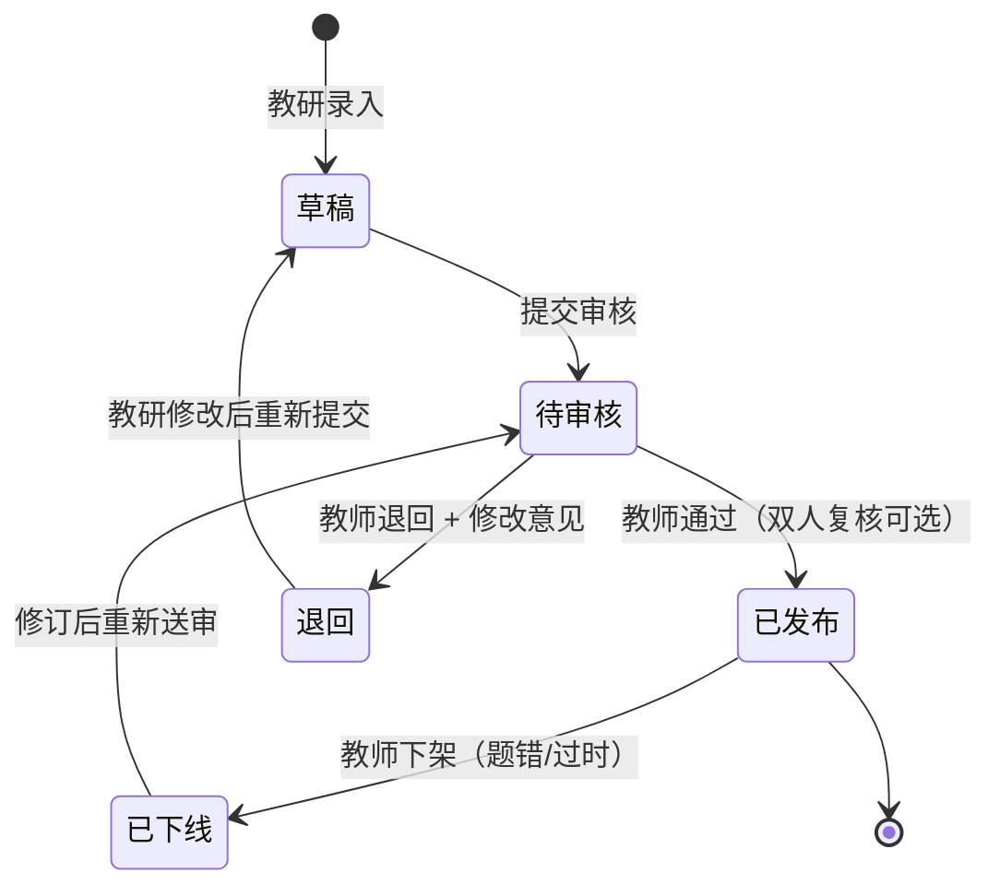
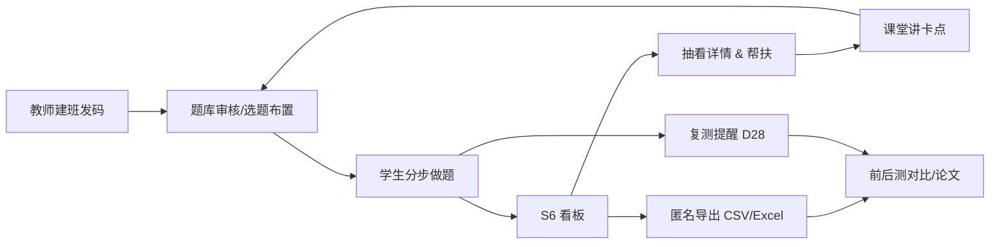

# 05-教师端与数据闭环

> 版本 v1.0 ｜ 日期 2026-10-31 ｜ 作者：产品设计（product-designer）｜ 阅读对象：罗老师、甲方、技术、研究/论文同事
> 依据：`../00-过程记录/02-流程与页面契约.md`（下称《契约》）第 2、3、5、8 节；《需求确认书》第四、五、七章与 D6/D9 勾选项
> 边界：本轮原型只做 S6 一屏看板；本文其余功能（审题后台、导出、复测）写规格不做界面。

---

## 0. 一页纸

- **教师每周只花 1.5 小时**（《需求确认书》风险表口径），换来三件事：知道谁掉队、知道全班卡在哪、拿到能写进课题的数据。
- **闭环七步**：建班发码 → 审题 → 看板 → 抽看过程 → 导出 → 复测 → 回看对比。
- **五个核心指标**：完成率、未完成名单、平均提示轮数（带解释）、卡点知识点 Top5、独立完成三档（分列）；外加研究用的前后测提升与保留率。
- **两条合规底线**：默认匿名导出（姓名/学号不出系统）；题库不经教师审核不上线。

---

## 1. 白话名词

| 名词 | 白话解释 |
|---|---|
| 完成率 | 老师布置的题里，学生真正做完的比例。 |
| 未完成名单 | 这周该做但没做完的学生（匿名 ID），用来点名帮扶，不公示。 |
| 平均提示轮数 | 完成一道题平均用了几次提示；太高说明题太难或引导失效。 |
| 卡点知识点 | 学生反复卡住的知识点，比如「一致收敛」「交错级数条件核对」。 |
| 独立完成率 | 全程没用最重的两级提示（L3/L4）就把题写完的比例；衡量「是不是真会了」。 |
| 前后测提升 | 学期初和一个月后做同难度不同题，两次平均分之差。 |
| 保留率 | 延迟后测成绩 ÷ 后测成绩，看一个月后还记得多少。 |
| 题库审核 | 题目必须经任课教师看过、确认公式/要点/提示没问题，才能给学生做。 |
| 匿名导出 | 导出的表格里只有随机编号，没有姓名和学号，写论文/统计不涉及个人身份。 |

---

## 2. 教师旅程（建班发码 → 审题 → 看板 → 抽看 → 导出 → 复测）

| 步 | 教师动作 | 在哪个页面/方式 | 耗时 | 产出 | 频率 |
|---|---|---|---|---|---|
| 1 建班发码 | 填班级名、人数 → 生成 6 位邀请码 → 发到班级群 | 教师后台（本轮原型演示态） | 2 分钟 | 班级 + 邀请码 | 开学/试点前一次 |
| 2 选题布置 | 按章节/知识点勾选本周 3 题（必做） | 教师后台题库页 | 5 分钟 | 本周任务清单 | 每周一次 |
| 3 审题 | 逐题检查题干、公式、关键要点、L1–L4 提示语；通过/退回 | 教师后台「题库审核」 | 10 分钟/题（首周集中） | 已发布题目 | 新题入库时 |
| 4 看板 | 看完成率、未完成名单、平均提示轮数、卡点 Top5、独立完成率 | S6 一屏看板 | 3 分钟 | 「本周要帮扶谁、下周讲什么」 | 每周一次 |
| 5 抽看过程 | 点学生 → 详情抽屉：每题每步、提示记录、用时、首个错误、是否独立完成 | S6 详情抽屉 | 5 分钟/2 名学生 | 个体帮扶依据 + 教学案例 | 每周一次 |
| 6 导出 | 选周次/组别 → 导出 CSV / Excel（默认匿名） | S6 导出按钮 | 1 分钟 | 班级/课题数据表 | 每周或每阶段 |
| 7 复测 | D28–D30 组织平行卷（同知识点、同难度、不同题），D0 前测已有数据 | 线下 + 后台配置 | 30 分钟 | 前后测配对数据 | 试点末一次（可选 D56–D60 延迟测） |

### 2.1 教师每一次点击的系统反馈（S6 交互口径）

- 点击指标卡 → 下钻到对应名单/题目列表；「平均提示轮数」悬停/点问号显示解释：「同一道题内平均用了几次提示。同题看思路难度，跨题看练习量，别把多做题当成不认真。」（C4）
- 点击未完成学生 → 抽屉显示「卡在哪个阶段、最后一次操作时间、是否断线」；
- 点击卡点知识点 → 显示该知识点下所有题 + 卡住人数；
- 导出前弹「默认匿名导出（不含姓名/学号）」确认；如需实名导出需二次确认并留痕（《需求确认书》D9-03）。

---

## 3. 指标定义与计算公式

> 所有指标分母都排除 `demo_flag=true` 的演示数据；统计周期默认「自然周（周一 00:00–周日 24:00）」。

### 3.1 教师看板五指标（《契约》第 8 节）

| 指标 | 公式 | 解释与阈值 | 看板展示 |
|---|---|---|---|
| 完成率 | 完成题次 ÷ 布置题次 × 100% | 完成 = 提交终稿且覆盖 ≥80%；<60% 标黄提醒 | 大数字 + 与上周对比 |
| 未完成名单 | 布置题次中 `completed=false` 的学生匿名 ID 列表 | 显示卡在第几阶段、最后活跃时间；不公示 | 列表（可导出） |
| 平均提示轮数 | 同题：Σ信息型提示次数（L1–L4）÷ 完成题次；跨题：Σ提示次数 ÷ 学生完成题数 | 2.5–4.5 正常；>6 视为引导失效；L0 单独统计不混入。**看板上必须带解释文案并区分同题/跨题，避免误读为「学生不认真」**（C4） | 大数字 + 问号解释 + 分布 |
| 卡点知识点 Top5 | 卡点事件数按知识点聚合排序取前 5 | 卡点事件定义见 3.2；同数按平均提示次数降序 | 列表 + 人数 + 平均提示 |
| 独立完成三档 | 独立、半独立、依赖三个题次分别 ÷ 完成题次 | 不合成单一百分比（C1）；独立+半独立合计参考 ≥70%（待验证）；依赖占比高说明提示过强/题太难 | 三个小数字并排 + 各自下钻名单 |

### 3.2 卡点事件的定义（避免口径争议）

一个「卡点事件」= 同一学生在同一题、同一知识点上满足任一：

1. 信息型提示累计 ≥3 次；
2. 同一错误点连续失败 ≥2 轮；
3. 终稿覆盖 <80%；
4. 中途放弃（在 P3 之前退出）。

> 同一题只计一次，避免「越卡越多次」放大。卡点知识点 Top5 = 按事件数排序 + 显示涉及学生人数。

### 3.3 研究/课题指标（对齐《需求确认书》第五章导出表）

| 指标 | 公式 | 用途 |
|---|---|---|
| 前后测提升 | 后测均分 − 前测均分 | 判断是否进步（同知识点、同难度、不同题） |
| 组间差 | 实验班提升 − 对照班提升 | 判断产品增量（目标实验班多 ≥8 个百分点） |
| 独立完成率 | 见 3.1 | 判断是否依赖提示 |
| 提示依赖 | (L3+L4 次数) ÷ (L1–L4 总次数) × 100% | 看引导是否过强 |
| 平均每题提示次数 | Σ提示次数 ÷ 完成题次 | 看引导强度 |
| 步骤完整率 | 学生写出的关键步骤数 ÷ 参考关键步骤数 | 看证明结构是否完整 |
| 保留率 | 延迟后测成绩 ÷ 后测成绩 | 看一个月后还记得多少 |
| 周活跃率 | 每周至少使用 1 次的学生数 ÷ 入班学生数 | 目标 ≥70% |
| 放弃率 | 中途退出题次 ÷ 开始题次 | 目标 ≤15% |

> 口径种子：v1.0 第 8 节、《需求确认书》第五章指标表、调研草稿 04 的 4.8.2（草稿，标注「待验证」，最终以产品埋点定义为准）。

### 3.4 指标诚实性原则

- 看板上的每个数字都必须能下钻到明细；不能下钻的指标不上看板。
- 「独立完成」三档只用于教学观察，**不进入学生评价、不告知学生**（v1.0 4.9.3 非惩罚原则）；三档不合并成单一百分比（C1）。
- 样本量 <10 时不显示百分比，只显示「人数」（防止误读）。

### 3.5 口径变更记录（《契约》4.1，2026-10-31 拍板）

| 编号 | 变更 | 对看板/导出的影响 |
|---|---|---|
| C1 | 独立完成拆三档（独立=只用 L0；半独立=L1–L2；依赖=L3–L4 或粘贴） | 看板三个数分列；导出新增 `independence_level`；不再输出单一「独立完成率」 |
| C3 | 学生端计时弱化，教师端保留完整计时 | 看板/导出保留 `time_on_task`、单步停留、断线时长，仅教师可见 |
| C4 | 平均提示轮数带解释文案，区分同题/跨题 | 看板指标卡加问号解释与同题/跨题切换 |
| C6 | 提示预算用尽软着陆 | 新增「薄弱点标记」字段与「软着陆出口选择」记录，教师端可看学生被建议去了定义卡/换题/转教师 |

---

## 4. 学生详情抽屉字段

> 入口：S6 学生列表点击行 → 右侧抽屉（手机端全屏）。类比：像老师翻一个学生的作业本，但看到的是过程而不只是对错。

| 分组 | 字段 | 说明 |
|---|---|---|
| 基本信息 | 匿名 ID、班级、组别（实验/对照）、年级 | 不显示姓名/学号 |
| 总览 | 完成题次、平均提示次数、独立完成三档题次（独立/半独立/依赖）、平均用时、放弃次数 | 一眼看依赖度（C1） |
| 逐题卡 | 题号、章节/知识点、难度 | 每道题一张卡 |
| 过程 | 每步学生输入与依据、每轮提示等级与原文、首个错误类型与位置、阶段轮次分布（P1–P6）、覆盖度、完整计时（单题总时长/单步停留/断线时长，C3） | 可「按时间回放」 |
| 异常 | 拒绝次数、小白解释次数、粘贴标记、断网/切屏次数、重复提交次数、薄弱点标记与软着陆出口（C6） | 只做教学提醒，不处罚 |
| 产出 | 五问复盘卡、3–5 条规律、自检卡、掌握度 | 学生自己写的资产 |
| 操作 | 「导出该生记录（匿名）」「标记为需帮扶」 | 便于教师跟进 |

---

## 5. 题库审核状态机

### 5.1 状态与门禁

| 状态 | 含义 | 学生端是否可见 | 谁能操作 |
|---|---|---|---|
| 草稿 | 教研录入中 | 否 | 教研/助教 |
| 待审核 | 等任课教师审 | 否 | 教师审核 |
| 已发布 | 审核通过，可被布置/选练 | 是 | 教师 |
| 退回 | 有问题，需修改（附修改意见） | 否 | 教研修改 |
| 已下线 | 发布后发现错误，下架 | 否（已开始做的学生可看草稿） | 教师 |

### 5.2 发布门禁（全部满足才可点「通过」）

1. 题干 LaTeX 渲染无误（抽检 ≥90% 无需改，见《需求确认书》验收 1）；
2. 关键步骤要点 ≤5 条、每条一句、不含推导；
3. L1–L4 提示语各 ≥1 条，且符合信息量上限（见 04 文档第 3 节）；
4. **题库里不存学生可见的参考证明**（v1.0 9.3 第 3 条）；
5. 核对清单已问句化（无陈述句泄题）；
6. 标明知识点、难度、预估用时、变式题题面；
7. 无公式/定理错误（教师本人确认）。

### 5.3 审核节奏（现实约束）

- 50 题 × 10 分钟 ≈ 8.3 小时；建议分两周：第 1 周 20 题先上线、第 2 周补齐。
- 双人复核可选（《契约》D6）；单人审核时，项目组抽检 10% 做兜底。
- 审核记录留痕：谁审的、何时、是否通过、修改意见。

---

## 6. 导出字段表（对齐《需求确认书》第五章）

### 6.1 六类字段

| 类别 | 导出字段 | 说明 |
|---|---|---|
| 学生 | 匿名 ID、班级、组别、年级 | 不含姓名/学号 |
| 题目 | 题号、知识点、难度、前/后测标记 | 可追溯到题库 |
| 作答 | 开始时间、提交时间、用时、提交次数 | 每次尝试一行 |
| 步骤/提示 | 步序、步骤得分、首个错误、提示次数、最高提示级别 | 长表格式（one row per turn） |
| 结果 | 完成、独立完成三档（independence_level）、总用时/单步停留、总分/步骤/逻辑/严谨分 | 教师评分优先，AI 不判分；三档不合成百分比（C1/C3） |
| 复测 | 前测 ID、后测 ID、是否配对、延迟测 | 用于配对分析 |

### 6.2 本产品补充的过程字段（长表列，便于写论文）

在《需求确认书》字段基础上增加：

| 列名 | 含义 | 取值示例 |
|---|---|---|
| stage | 当前阶段 | P1–P6 |
| hint_level | 本轮提示等级 | L0–L4 |
| hint_text | 提示原文 | 「这题的关键是莱布尼茨判别法…」 |
| diagnosis_type | 首个错误类型 | 条件缺失/逻辑断链/表述不严/方向错/计算笔误 |
| keypoint_coverage | 要点覆盖 | 4/5 |
| budget_used | 预算消耗 | L1=2;L2=1;L3=0;L4=0 |
| refusal_count | 拒绝次数 | 1 |
| plain_explain_count | 小白解释次数 | 1 |
| paste_flag | 粘贴标记 | true/80 字 |
| stall_min | 最长单步停留 | 6.5 |
| offline_cnt / focus_lost_cnt | 断网/切屏次数 | 2 / 1 |
| completed / abandoned | 完成 / 放弃 | true / false |
| mastery_score | 掌握度 | 72 |
| class_code | 匿名导出批次码 | 2026W1-EXP |

### 6.3 格式与质量

- 格式：CSV（UTF-8 带 BOM，Excel 直接开）+ Excel；字段齐全率 ≥98%（《需求确认书》验收 5）。
- 口径说明随文件附一页「字段字典」，避免研究者自行猜测。
- 导出默认匿名；实名导出需二次确认 + 审批留痕。

---

## 7. 匿名与合规

| 事项 | 要求 | 落地 |
|---|---|---|
| 数据最小化 | 只收完成练习必需的信息 | 入班只需邀请码 + 学号；学号仅用于本地对照 |
| 默认匿名导出 | 表格无姓名/学号，只有匿名 ID/班级/组别 | 导出前强制确认 |
| 对照表保管 | 「账号码—学号」对照表由教师本地保存，不上传、不入导出 | 后台仅显示匿名 ID |
| 知情同意 | 试点前告知学生：会被记录过程数据、用于教学改进/研究；可退出 | 首次登录一屏说明 + 勾选 |
| AIGC 标识 | AI 生成内容需标识 | 学生端 AI 消息标注「AI 陪练」；教师端说明 AI 仅引导 |
| 境内模型 | 使用境内大模型服务，不跨境传输学生数据 | 技术方案约束（DeepSeek 等境内 API） |
| 隐私政策/用户协议 | 齐备并可在登录页查看 | 合规检查项（《需求确认书》7.1 验收 6） |
| 备份恢复 | 2 小时内可恢复 1 次（验收 6） | 技术方案负责 |
| 研究伦理 | 对照班不得被剥夺正常教学；实验数据只用于约定用途 | 与学校/课题约定 |

> 小程序备案、隐私协议、AIGC 标识的具体合规要求以官方最新规定为准；本文件只列产品侧动作，**待技术/合规同事确认**。

---

## 8. 教师课前 / 课后各做什么（可执行清单）

### 8.1 课前（每周一次，约 10–15 分钟）

1. **看上周卡点 Top5**（2 分钟）——决定这周课堂要讲的 1 个点。
2. **选本周 3 题**（5 分钟）——优先覆盖卡点知识点；确认是「已发布」题。
3. **确认班级状态**（2 分钟）——邀请码有效、入班人数与名单一致。
4. **跟学生说一句话**（1 分钟）：「这周 3 道题，卡住就点提示，用提示不扣分、也不排名。」
5. **需要新题则走审核**（10 分钟/题，可提前批量做）。

### 8.2 课后 / 每周固定（约 15 分钟 + 周五 30 分钟复盘）

1. **看完成率与未完成名单**（3 分钟）——私聊 / 课间帮扶 2–3 名未完成学生。
2. **抽看 2 名学生过程**（5 分钟）——各看 1 道题的提示记录、首个错误、独立完成档位与薄弱点标记（C1/C6）。
3. **标记 1 个线下要讲的卡点**（2 分钟）——把「卡点知识点 Top5」第一条用于下次课。
4. **导出本周数据**（1 分钟）——匿名 CSV/Excel 存档，课题用。
5. **每周五复盘 30 分钟**（与项目组）——看提示依赖、独立完成率、AI 合规抽检结果；决定下周是否调题、调提示阈值。
6. **复测周（D28–D30）**：组织后测（30 分钟、3 题平行卷），导出配对数据；可选 D56–D60 延迟后测。

### 8.3 教师时间预算总表（回应「教师时间不够」风险）

| 时段 | 频次 | 时长 | 累计（4 周试点） |
|---|---|---|---|
| 建班发码 + 首周审题 20 题 | 一次性 | 约 3.5 小时 | 3.5 小时 |
| 每周课前 | 每周 | 10–15 分钟 | 约 1 小时 |
| 每周课后 | 每周 | 15 分钟 | 约 1 小时 |
| 周五复盘 | 每周 | 30 分钟 | 2 小时 |
| 后续补审 30 题 | 一次性 | 约 2.5 小时 | 2.5 小时 |
| 复测组织 | 试点末 | 30 分钟 | 0.5 小时 |
| **合计** | | | **约 10.5 小时 / 4 周** |

> 若不可接受，可把「审题」改为教研预审 + 教师只做终审（每题 3 分钟），总时长降至约 7 小时。

---

## 9. 数据闭环图

---

## 10. 与《契约》的对齐与待拍板

- 已对齐：《契约》第 2 节教师诉求、第 3 节教师闭环、第 5 节 S6 关键元素、第 8 节看板指标与匿名口径；《需求确认书》第五章导出字段、验收 4/5/6。
- **本文补充**：《契约》未展开的卡点事件定义、审核门禁、教师时间预算、导出长表字段。
- **待拍板**：
  1. 卡点事件定义是否按本文 3.2（同一题只计一次）——影响「卡点 Top5」口径；
  2. 双人复核是否启用（《契约》D6 可选，本文默认单人 + 抽检 10%）；
  3. 「作业布置」入口是否做（本文按《需求确认书》「不做」，仅保留选题布置的配置能力）；
  4. 实名导出的审批人是谁（教师本人 / 项目组）；
  5. 复测卷由谁出（罗老师 / 项目组教研），本文默认罗老师出题、项目组配置。

---

## 11. 引用

- 《契约》：`D:\DeepSeek Harness\数学分析证明题智能体\证明陪练场_产品设计工作区\00-过程记录\02-流程与页面契约.md` 第 2、3、5、8 节与 D6/D9
- 《学生端回答方案_v1.0》：`D:\DeepSeek Harness\数学分析证明题智能体\智能体回答思路设计\学生端回答方案_v1.0.md` 第 7.1 完成判据、第 8 节质量保障
- 《需求确认书》：`D:\DeepSeek Harness\数学分析证明题智能体\智能体回答思路设计\数学分析证明题辅导智能体_需求确认书20261027(1).docx` 第四章教师端、第五章复测与导出字段、第七章合规与验收、D6/D9 勾选项
- 调研草稿（内部口径，待验证）：`D:\DeepSeek Harness\数学分析证明题智能体\_research\drafts\04-引导策略与Prompt模板.md` 4.2.3、4.8.2；`05-技术架构与部署成本.md`（部署与合规，属技术方案同事范围）
