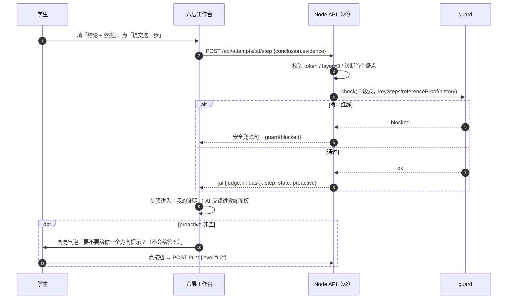

# 07-六层引导工作台规格（v2）

> 版本 v2.0 ｜ 日期 2026-10-31 ｜ 作者：产品设计（product-designer）｜ 阅读对象：甲方产品负责人、罗老师、前端/后端开发、评审
> **唯一事实源**：`../../06-前后端Demo/docs/SIX_LAYER_V2_CONTRACT.md`（下称《v2 契约》）；本文是它的「产品说明书 + 交互规格」，冲突以 v2 契约为准。
> 前置阅读：`02-学生端使用流程PRD.md`（v1 六阶段流程）、`04-AI引导与提示阶梯规格.md`（L0–L4 与红线）、`../../01-需求与背景/05-六层讲解与红线的结合.md`（六层为什么这样改）。
> 当前状态：v2 前端（`public/`）与后端（`server/`）**正在按 v2 契约改造**；本文先按契约写全，实现落地后按第 10 节逐条核对。

---

## 0. 一页纸

### 0.1 为什么做 v2（用户原话 → 对策）

| 用户反馈（v1 全栈 Demo） | 问题本质 | v2 对策 |
|---|---|---|
| 「看不到六层」 | 界面只显示 P1–P6 证明流程，第一版六层（前置知识/解析/步骤/讲解/同类题/总结）被藏进内部 | **六层 stepper 常驻顶部**，六层原名全部出现，每层独立任务卡、输入区、提交按钮、完成状态 |
| 「不知道在哪提交」 | 提交入口混在聊天框附近，学生以为是「继续聊天」 | **每层主区域一个大输入 + 一个主按钮**（提交我的理解 / 提交解析 / 提交这一步 / 提交完整讲解 / 提交变式题 / 提交总结），提交后内容进入「我的记录」 |
| 「AI 像旁白」 | AI 只在旁边答话，不告诉学生「现在该你做什么」 | **AI 教练常驻右上角**，顶部固定一句「现在请你做：…」；提交后才给反馈；同一处连错 2 次**主动 offer** 方向提示 |
| 「提示要自己找」 | 提示按钮藏在二级浮层，学生不知道有提示 | **提示按钮组常驻**（L0–L4 + 剩余次数 + 锁定状态），「我要答案」入口也常驻 |

### 0.2 三句话记住 v2

1. **六层是主流程，不是隐藏内容**：六层每一步都看得见、点得到、交得上。
2. **学生先做，AI 后说**：每层都是学生先提交，AI 再反馈；AI 不替学生产出六层内容。
3. **AI 是教练，不是旁白**：告诉你现在做什么、下一步是什么；卡住了主动递「最小提示」，永远不给答案。

### 0.3 六层一览（学生看到的顺序）

```text
① 前置知识点 → ② 题目解析 → ③ 详细步骤 → ④ 完整讲解 → ⑤ 同类题 → ⑥ 总结
（专业+高中）  （你拆，AI 查漏）（一步一依据）  （你讲，AI 核对）（换题再做）（知识点/重难点/步骤）
```

---

## 1. 先给非数学专业读者：五个词说清

| 词 | 白话解释 |
|---|---|
| 前置知识点 | 做证明前要会的定义/定理，比如「条件收敛（带上正负号才收敛、去掉负号就发散）」。v2 里学生先回答「记不记得」，忘了可以调取知识点卡。 |
| 题目解析 | 学生先自己拆：这题要证什么、要证几件事、关键词是什么。AI 只查漏，不替学生讲思路。 |
| 详细步骤 | 一步一句：写这一步的结论/操作 + 为什么能这么写（依据）。证明题的核心就在这层。 |
| 完整讲解 | **由学生把整道题讲一遍**，AI 按五个检查点（目标/结构/关键步骤/依据/结论）核对缺口。旧版这里是 AI 讲完整题——那正是「给答案」，已禁止。 |
| 同类题 | 换一道同知识点、不同题面的题让学生独立做，检验方法会不会迁移。 |
| 总结 | 学生自己写：学到的知识点、最容易错的重难点、下次的解题步骤；AI 只校正表述。 |
| stepper（步骤条） | 页面顶部的一排圆点/标签，显示六层进度和当前在哪一层。 |
| AI 教练 | 右侧常驻面板：顶部写「现在请你做：…」，下方给反馈、提示按钮和主动 offer。 |
| 主动 offer | AI 发现学生同一处连续错 2 次时，主动弹一个气泡：「要不要给你一个方向提示？（不会给答案）」——学生点一下才给。 |
| 红线 | 不出现完整证明、最终答案、可抄推导链、编号骨架。六层里的所有内容都由学生先产出。 |

---

## 2. 核心设计原则（产品版）

| # | 原则 | 落地 |
|---|---|---|
| P1 | 六层显式可见 | 顶部 stepper 用六层原名；当前层高亮；已完成打勾；未解锁灰色 + 一句「先完成上一层」。 |
| P2 | 学生先做，AI 后说 | 每层有唯一主提交按钮；**点提交之前 AI 不替学生产出内容**；提交后 AI 反馈出现在右侧教练面板。 |
| P3 | 提交入口唯一且明显 | 主区域「大输入 + 主按钮」；按钮在输入区正下方（手机端 sticky 底部）；提交成功有 toast「已记录到『我的记录』」。 |
| P4 | AI 教练常驻 | 右上/右侧面板顶部固定「现在请你做：…」；下方三段式反馈；底部提示按钮组常驻。 |
| P5 | 提示常驻、主动 offer | L0–L4 按钮 + 剩余次数常显；连续失败 2 次后端返回 proactive，前端高亮气泡「给我一个方向提示（L2）」。 |
| P6 | 红线不变 | AI 只做判断/追问/点名知识点/最小提示；完整讲解=学生讲；知识点卡=学生主动调取；无「参考证明」入口。 |

---

## 3. 六层总表（产品与开发共同口径）

| 层 | UI 名称 | 副标题（按钮上方） | 学生任务 | AI 只做什么 | 完成判据 | 对应 v1 阶段 | 红线一句话 |
|---|---|---|---|---|---|---|---|
| 1 | 前置知识点 | 专业 + 高中 | 回答记得/忘了/没学过；核对定义；需要时调取知识点卡 | 提问；给知识点卡（专业版/高中版）；判定复述 | 复述通过，或 2 次后带病前进 | P1 知识激活 | 提醒知识点=点名+提问，不替学生理解 |
| 2 | 题目解析 | 你拆，AI 查漏 | 填四栏：要证什么 / 几件事 / 关键词与量词 / 可能用到的知识点 | 逐项查漏；给「高中版题意」（只换说法，不给解法） | 四栏无缺项或补到通过 | P2 学生拆题 | 不列「考什么、用什么方法」 |
| 3 | 详细步骤 | 一步一依据 | 每步写「结论/操作 + 依据」→ 提交；卡住点提示 | 只指第一处可疑、追问依据、L0–L4 提示、主动 offer | 覆盖 ≥80% 且学生点「写完了」 | P3 分步推进 | 只给最小提示，给一步立即交还 |
| 4 | 完整讲解 | 你讲，AI 核对 | 像给同学讲题一样完整讲一遍（目标/结构/关键步骤/依据/结论） | 按五项检查点给缺口清单与追问，不给标准讲解 | 讲解覆盖 ≥80% | P4 终稿核对 + P5 复盘（合并为「学生讲」） | **完整讲解由学生完成，AI 不提供标准讲解** |
| 5 | 同类题 | 换题再做 | 做一道同知识点、不同题面的题，写答案/关键步骤 | 只判对错 + 一条追问，不给解法 | 答案正确 | P6 变式题 | 只给题面，学生独立做 |
| 6 | 总结 | 知识点 / 重难点 / 步骤 | 用自己话写三栏：知识点、重难点、下次步骤 | 校正表述、生成总结卡、给掌握度 | 三栏完成且 AI 校正 | P6 三样交付 | 总结必须是学生自己的话 |

> 六层「顺序没变，主语全换」：旧版每层是「AI 讲给你听」，v2 每层是「学生先做 + AI 检查」。

---

## 4. 页面结构（学生端 S3）

### 4.1 桌面（≥1024px）

```text
┌──────────────────────────────────────────────────────────────┐
│ 顶栏：证明陪练场 | ① 学生端 ② 教师端 ③ 后端与数据 ④ 说明       │
├──────────────────────────────────────────────────────────────┤
│ 题目卡（题面 + 知识点标签 + 预计时间 + 保存返回）              │
├──────────────────────────────────────────────────────────────┤
│ 六层 stepper：①前置知识点 ②题目解析 ③详细步骤 ④完整讲解 ⑤同类题 ⑥总结 │
├──────────────────────────────────┬───────────────────────────┤
│ 左 60%：当前任务卡（A–E）        │ 右 40%：AI 教练（F–J）     │
│  A 层标题 + 一句任务说明         │  F 「现在请你做：…」（常驻）│
│  B 输入区（大）                  │  G 最新反馈（三段式）      │
│  C 主提交按钮                    │  H 提示按钮组 L0–L4 + 余量 │
│  D 我的记录 / 我的证明（历史）   │  I 「我要答案」拒绝入口    │
│  E 知识点卡 tabs（第 1 层）      │  J 主动 offer 高亮气泡     │
├──────────────────────────────────┴───────────────────────────┤
│ 手机端：任务卡 + 输入区堆叠；底部 sticky「提交」+「卡住了？」   │
└──────────────────────────────────────────────────────────────┘
```

### 4.2 区域与固定规则

| 区域 | 内容 | 固定规则 |
|---|---|---|
| A 层标题 | 「第 N 层 · 名称」+ 一句任务说明 + 提交按钮文案 | 每层文案不同，见第 5 节；必须写清「现在做什么」 |
| B 输入区 | 第 1/2/4/6 层为大文本框；第 3 层为「结论/操作 + 依据」两个输入框；第 5 层为答案框 | 学生输入前 AI 不产出内容；支持草稿自动保存 |
| C 主提交按钮 | 文案随层变化；主色、全宽（手机端 sticky） | 唯一入口，不藏在聊天框；提交中禁用防连点；完成后变为「已提交」 |
| D 我的记录 | 第 3 层显示「我的证明」步骤列表（结论+依据+状态+AI 一句话）；其他层显示已提交内容 | 只读回看，不在列表里直接改（改要点「回到这一步」） |
| E 知识点卡 | 第 1 层：tabs「专业知识点 / 高中水平解读」；第 2 层：「看高中版题意」 | 学生主动点开才显示；卡里只有定义/换说法，没有解法 |
| F 教练指令 | 常驻「现在请你做：…」；随层变化 | 不用学生问「然后呢」 |
| G 最新反馈 | 三段式：【判断】引用学生原话 →【提示】→【提问】 | 每轮正文 ≤130 字（L4 ≤200）；不带完整证明 |
| H 提示按钮 | L0/L1/L2/L3/L4 + 剩余次数 + 锁定/用尽状态 | 常驻可见；点击直接调 `/hint`；锁定需说明原因 |
| I 要答案 | 弱化文字链「我卡住了，想直接看答案」 | 点开三段式拒绝 + 四选一替代动作（沿 v1） |
| J 主动 offer | 高亮气泡：「要不要给你一个方向提示？（不会给答案）」+ 按钮「给我一个方向提示（L2）」 | 只在后端返回 proactive 时出现；点按钮 = 调 `/hint L2` |

### 4.3 手机窄屏（390px）

- stepper 横向可滑动（或换行两行），当前层始终可见；
- 任务卡与 AI 教练上下堆叠：先生成任务卡（输入+提交），AI 反馈在下方；「提交」和「卡住了？」底部 sticky；
- 键盘弹起时输入区上移，提交按钮不被遮挡；
- 提示按钮收成一行可横滑的胶囊，仍显示剩余次数；无横向溢出。

> 依据：《v2 契约》§2；页面编号沿用 v1：S0 登录 / S1 首页 / S2 选题 / S3 六层工作台 / S4 完成页。

---

## 5. 逐层交互规格

> 通用：每层 AI 反馈都在学生**提交之后**出现；每层通过后 stepper 当前层置 ✓、下一层点亮；每层都可「保存返回」离开，回来续做。

### L1 前置知识点

| 项 | 规格 |
|---|---|
| 标题 | 第 1 层 · 前置知识点（副标题：专业 + 高中） |
| AI 常驻指令 | 「先别急着写证明。你记得『条件收敛』和『莱布尼茨判别法』吗？先选一个。」 |
| 输入区 | 大文本框，占位「用自己的话说：条件收敛和收敛有什么区别？」 |
| 快捷按钮 | 「我记得，直接核对」「我忘了，看知识点卡」「完全没学过，只看高中版」 |
| 提交按钮 | **提交我的理解** |
| 反馈 | 学生提交后：判断（是否抓住区别）→ 追问（缺的那半句）→ 需要时给知识点卡；连续 2 次未过→带病前进标记 |
| 知识点卡 | tabs：专业知识点（严格定义/定理原文）/ 高中水平解读（一句类比 + 与本题无关的最小例子 + 回到严格表述） |
| 完成判据 | 复述通过，或 2 次后带病前进（记录薄弱点） |
| 红线 | 只点名/给原文，不替学生理解；知识点卡里不得出现本题关键构造 |
| 异常 | 空提交 → 提示「先写一句你自己的话」；只贴定义原文 → 判为「复述但未理解」，追问区别 |

### L2 题目解析

| 项 | 规格 |
|---|---|
| 标题 | 第 2 层 · 题目解析（副标题：你拆，AI 查漏） |
| AI 常驻指令 | 「这题要你证什么？分几件事？关键词和『任意/存在』这类词各是什么？你先拆。」 |
| 输入区 | 四栏：① 要证什么 ② 要证几件事 ③ 关键词与量词 ④ 可能用到的知识点 |
| 辅助按钮 | 「看高中版题意（只换说法）」 |
| 提交按钮 | **提交解析**（契约文案也写作「提交我的解析」） |
| 反馈 | 逐项 ✓ / 缺 / 需改（如「你说了收敛，漏了『不绝对收敛』这一半」）；不列考点、不给方法名 |
| 完成判据 | 四栏无缺项或补到通过 |
| 红线 | 「高中版题意」只换说法，不夹带解法（禁止出现「用莱布尼茨」这类话） |
| 异常 | 只填一栏 → 提示缺哪栏；把解法写进「知识点」栏 → 指出「这栏只要知识点名，不要做法」 |

### L3 详细步骤（核心）

| 项 | 规格 |
|---|---|
| 标题 | 第 3 层 · 详细步骤（副标题：一步一依据） |
| AI 常驻指令 | 「现在写第 1 步：先证单调递减。写『结论/操作 + 依据』，然后点提交。」 |
| 输入区 | 两个输入框：「这一步的结论/操作」+「这一步的依据（定义/定理/上一步）」 |
| 提交按钮 | **提交这一步** |
| 我的证明 | 列表显示第 N 步：结论 + 依据 + 状态（通过 / 待改 / 被标疑点）+ AI 一句话反馈；可点「回到这一步」改 |
| 反馈 | 三段式：只指第一处可疑 → 追问依据 → 不够才升提示；给完一步立即交还 |
| 提示区 | L0–L4 按钮 + 剩余次数；锁定显示「先提交一次 / 先用上一级」；用尽走软着陆 |
| 主动 offer | 同一层/同一步连续失败 ≥2 次 → 气泡「要不要给你一个方向提示？（不会给答案）」→ 点按钮调 `/hint L2` |
| 完成判据 | 学生点「写完了」+ 覆盖 ≥80% → 进入 L4 |
| 红线 | 不给完整证明/下一步做法/编号步骤；每步必须有依据 |
| 异常 | 空提交、粘贴、看不懂、要答案、断网、重复提交——见第 8 节 |

### L4 完整讲解（你讲，AI 核对）

| 项 | 规格 |
|---|---|
| 标题 | 第 4 层 · 完整讲解（副标题：你讲，AI 核对） |
| 固定说明 | **「完整讲解由你完成，AI 只核对缺口，不提供标准讲解。」**（UI 必须显示这句） |
| AI 常驻指令 | 「像给同学讲题一样，把整道题讲一遍：要证什么、分几段、每段依据、结论。」 |
| 输入区 | 大文本框（可分段），占位「先说要证什么，再说分几段、每段依据是什么……」 |
| 提交按钮 | **提交完整讲解** |
| 反馈 | 五项 checklist：目标 / 结构 / 关键步骤 / 依据 / 结论；缺哪项说哪项 + 一个追问；不提供标准讲解 |
| 完成判据 | 讲解覆盖 ≥80%（五项中至少四类到位） |
| 红线 | **AI 永不输出标准讲解/参考证明**；不得用「我来帮你梳理一遍」变相代写 |
| 异常 | 讲得太短 → 「再补一句：分几段？」；直接抄终稿 → 提示「讲出来：为什么这一步不能省？」 |

### L5 同类题

| 项 | 规格 |
|---|---|
| 标题 | 第 5 层 · 同类题（副标题：换题再做） |
| 题干 | 固定变式题：∑(−1)^(n−1)/n²，判断收敛性并说明条件/绝对收敛 |
| AI 常驻指令 | 「换一道同类型的题，你自己做。写答案或关键步骤都行。」 |
| 输入区 | 答案/关键步骤文本框 |
| 提交按钮 | **提交变式题** |
| 反馈 | 只判对错 + 一条追问（如「绝对收敛的理由里，p 是多少？」）；不给解法 |
| 完成判据 | 答案正确 → 进入 L6 |
| 红线 | 只给题面；不讲解、不示范 |
| 异常 | 答错 → 一条追问，可再试（变式题独立预算）；不会 → 可回看第 3 层步骤，不允许 AI 代做 |

### L6 总结

| 项 | 规格 |
|---|---|
| 标题 | 第 6 层 · 总结（副标题：知识点 / 重难点 / 步骤） |
| AI 常驻指令 | 「用你自己的话写三栏：学到的知识点、最容易错的重难点、下次的解题步骤。」 |
| 输入区 | 三栏：① 我学到的知识点 ② 最容易错的重难点 ③ 下次的解题步骤 |
| 提交按钮 | **提交总结** |
| 反馈 | 校正表述（「这条不是动作，是名词，改成你下次先做什么」）+ 生成总结卡 + 掌握度 |
| 完成判据 | 三栏完成且 AI 校正 → 六层全部 done，attempt 结束 |
| 红线 | 不代写总结、不借总结再讲一遍题 |
| 异常 | 三栏只写一栏 → 指出缺哪栏；写空话 → 追问「具体下一步做什么」 |

---

## 6. AI 教练面板规格

### 6.1 面板结构（从上到下）

1. **常驻指令**（固定）：「现在请你做：{{本层任务}}」——随层/步骤变化，永远不空；
2. **最新反馈**（学生提交后出现）：严格三段式【判断】【提示】【提问】，正文 ≤130 字（L4 ≤200）；
3. **提示按钮组**（常驻）：L0 / L1 / L2 / L3 / L4 + 剩余次数 + 锁定/用尽状态；
4. **我要答案**（常驻弱化入口）：点击调 `/answer-request`，显示三段式拒绝；
5. **主动 offer 气泡**（条件出现）：后端 `proactive` 非空时高亮显示，一个按钮「给我一个方向提示（L2）」。

### 6.2 常驻指令文案（按层）

| 层 | 「现在请你做」 |
|---|---|
| L1 | 先别急着写证明：用自己的话说「条件收敛和收敛有什么区别」。 |
| L2 | 拆题：这题要证什么？要证几件事？关键词和量词是什么？ |
| L3 | 写第 N 步：这一步的结论/操作是什么？依据是哪条定义/定理/上一步？ |
| L4 | 把整道题讲给同学听：要证什么、分几段、每段依据、结论。 |
| L5 | 换一道同类型题，你自己做，写答案或关键步骤。 |
| L6 | 用你自己的话写三栏：知识点、重难点、下次步骤。 |

### 6.3 提示与拒绝（沿用 v1，位置常驻）

- 提示预算：L1≤3 / L2≤3 / L3≤2 / L4≤1（合计 ≤9）；L0≤6；小白解释≤2；单题轮次与时长沿用 v1。
- 锁定状态：未满足升级条件时按钮置灰 + 一行原因（「先提交一次尝试」「先用上一级」），不让学生觉得被耍；
- 用尽：显示软着陆四选一（只做 L0 / 看定义卡 / 换同知识点更简单题 / 转教师）；
- 「我要答案」：三段式拒绝 + 四选一替代动作，总长 ≤100 字，永不输出证明（详见 `04-AI引导与提示阶梯规格.md` 第 5 节）。

### 6.4 主动 offer 规则（v2 新增）

| 项 | 规则 |
|---|---|
| 触发 | 同一层/同一步连续失败 ≥2 次（由后端 `failedAttempts` 判定），后端在 `/step` 响应返回 `proactive:{offer:true, level:"L2", text:"要不要先给一个方向提示？不会给答案。"}` |
| 展示 | AI 教练面板高亮气泡 + 一个按钮「给我一个方向提示（L2）」 |
| 行为 | 点按钮 = 调 `POST /api/attempts/:id/hint {level:"L2"}`；成功则显示 L2 提示并扣预算；若 L2 不可用则展示原因 |
| 约束 | 一次失败只 offer 一次，不重复弹；学生可忽略继续写；offer 不等于自动给提示 |

### 6.5 AI 教练不能做的事（红线在 UI 的体现）

- 不主动给「标准讲解/参考证明」按钮；
- 不在学生提交前替学生产出本层内容；
- 不用「我来帮你梳理一遍」变相代写；
- 不显示内部关键要点原文（只转成问句/checklist）。

---

## 7. state 结构（产品含义版）

> 完整 JSON 见《v2 契约》§3；这里给产品/测试看的字段含义。

| 字段 | 含义 | 学生可见 | 用途 |
|---|---|---|---|
| `layer` / `layerLabel` | 当前层（1–6）与名称 | 是（stepper 高亮） | 决定显示哪层任务卡与指令 |
| `layerStatus` | 六层状态：active / done / locked | 是 | stepper 打勾、锁定、可点规则 |
| `guidance` | 本层标题、指令、输入占位、提交按钮文案、提示 tip | 是 | 渲染任务卡与 AI 教练指令 |
| `knowledge` | 第 1 层：知识点卡（专业/高中）、核对问题、学生答案、是否通过 | 是 | 第 1 层任务与知识点卡 |
| `parse` | 第 2 层：四栏内容、高中版题意、逐项反馈、是否通过 | 是 | 第 2 层四栏表单 |
| `steps` / `stepIndex` | 第 3 层：每步结论+依据+状态+反馈；当前第几步 | 是（我的证明） | 步骤列表与「回到这一步」 |
| `failedAttempts` | 当前处连续失败次数 | 否（进入 proactive 判定） | 触发主动 offer |
| `budgets` / `used` / `unlocked` | 提示预算、已用、已解锁等级 | 是（提示按钮） | 提示按钮状态由后端给，前端不推算 |
| `coverage` | 终稿覆盖（5 条问句要点） | 是（覆盖表） | 第 3 层完成判据之一 |
| `explanation` | 第 4 层学生讲解文本、五项反馈、是否通过 | 是 | 第 4 层任务与 checklist |
| `variant` | 第 5 层变式题：题面、学生答案、结果 | 是 | 第 5 层任务卡 |
| `summary` | 第 6 层三栏内容、反馈、总结卡、是否通过 | 是 | 第 6 层表单与总结卡 |
| `mastery` / `independence` / `finishedAt` | 掌握度、独立性三档、完成时间 | 完成页可见 | 完成页、教师端、导出 |

---

## 8. API 映射与提交时序

### 8.1 v2 接口一览（相对 v1 的新增/调整）

| 层 | 接口 | 请求 | 关键返回 |
|---|---|---|---|
| — | `GET /api/attempts/:id` | — | attempt + problem + state（含六层字段） |
| — | `POST /api/attempts` | `{problemId}` | 新建/恢复，`state.layer=1` |
| — | `GET /api/problems/:id/knowledge` | — | 知识点卡（专业/高中/核对问题），不含解法 |
| 1 | `POST /api/attempts/:id/knowledge` | `{action:"answer",answer}` 或 `{action:"request-card"}` | passed / feedback / state |
| 2 | `POST /api/attempts/:id/parse` | `{goal,parts,keywords,tools}` | feedback[] / passed / state / plainRestatement |
| 3 | `POST /api/attempts/:id/step` | `{conclusion,evidence}` | ai 三段式 / step / state / **proactive** |
| 3 | `POST /api/attempts/:id/hint` | `{level:L0–L4}` | 同 v1 + `plain`（这一步在干什么的白话版，不给结论/表达式） |
| 3 | `POST /api/attempts/:id/answer-request` | `{}` | 三段式拒绝 |
| 3 | `POST /api/attempts/:id/final` | `{text}` | coverage / passed → `layer=4` |
| 4 | `POST /api/attempts/:id/explain` | `{text}` | 五项 checklist / passed → `layer=5` |
| 5 | `GET /api/attempts/:id/variant` | — | 题面（title/stem） |
| 5 | `POST /api/attempts/:id/variant` | `{answer}` | result{correct,feedback} → `layer=6` |
| 6 | `POST /api/attempts/:id/summary` | `{knowledge,difficulty,steps}` | feedback / passed / card / mastery / independence / state（finishedAt） |

> 沿用的红线与规则：鉴权、错误格式、提示预算、解锁条件、防泄题 guard、拒绝模板、小白解释三件套均不变；学生端所有响应带 `state`。

### 8.2 一次提交的时序（以第 3 层为例）



---

## 9. 异常分支（v2 新增/调整）

| # | 异常 | 触发识别 | 工作台反应 | AI/后端处理 | 记录 |
|---|---|---|---|---|---|
| E1 | 学生完全不会、空提交 | 输入为空或「不会写」 | 主按钮旁提示「先写一句你自己的话」；不报错 | 给最小起步动作（仍 L0，不升级） | `empty_start_cnt` |
| E2 | 看不懂概念 | 输入含「看不懂/没学过/忘了」 | 第 1 层可点知识点卡；其他层弹小白解释卡（≤2 次） | 三件套 + 要求复述 | `plain_explain_count` |
| E3 | 要答案 | 点「我要答案」 | 教练面板显示三段式拒绝 + 四选一替代动作 | 永不返回证明 | `refusals` |
| E4 | 同一处连续失败 | `failedAttempts≥2` | 主动 offer 气泡（不强制） | 返回 proactive，点后给 L2 | `failedAttempts` |
| E5 | 提示未解锁/用尽 | 点灰按钮/429 | 显示原因/软着陆四选一 | 409/429 按 v1 口径 | `budgets` |
| E6 | 粘贴他人答案 | 单次 ≥80 字 | 不拦截；提交后轻提示 | 只点评一步 + `paste` 标记 | `pasteFlags` |
| E7 | 断网/切屏 | 网络失败/失焦 | 顶部黄条「草稿已保存」；恢复提示 | 不重置进度；恢复后继续 | `offline_cnt` |
| E8 | 刷新/关闭页面 | 重新打开 | 用 `GET /api/attempts/:id` 恢复当前层、输入、我的证明、提示计数 | 状态由后端返回，前端不推算 | `resume` |
| E9 | 误点未解锁层 | 点灰层 | 提示「先完成第 N 层」；不跳层 | `layerStatus` 不改 | — |
| E10 | 六层全部完成 | summary 通过 | 六层全 ✓ + 完成页（掌握度/总结卡/独立性档位/复测提醒） | 写 finish 事件 | `finishedAt` |

---

## 10. 验收清单（可直接勾选）

### 10.1 六层主流程（对齐《v2 契约》§6）

| # | 验收项 | 通过标准 |
|---|---|---|
| 1 | 打开 `?demo=1` | 六层 stepper 可见，当前第 1 层高亮；AI 教练写「现在请你做：…」 |
| 2 | 第 1 层知识点卡 | 可点「我忘了」看专业/高中两 tab；提交复述后进入第 2 层 |
| 3 | 第 2 层四栏 | 四栏可填；提交后 AI 逐项 ✓/缺/需改；通过进入第 3 层 |
| 4 | 第 3 层提交入口 | 两个输入框 + 「提交这一步」明显；提交后进入「我的证明」，AI 反馈自动出现 |
| 5 | 第 3 层主动 offer | 同一处连续失败 2 次出现主动提示气泡；点按钮才给 L2 |
| 6 | 第 3 层提示常驻 | 提示按钮组常驻且显示剩余次数；未解锁/用尽状态清楚 |
| 7 | 第 3 层要答案 | 点「我要答案」被三段式拒绝，无完整证明 |
| 8 | 第 3→4 层 | 学生点「写完了」且覆盖 ≥80% 才进入第 4 层 |
| 9 | 第 4 层 | 学生讲解 + 五项 checklist；AI 不给标准讲解；通过进入第 5 层 |
| 10 | 第 5 层 | 变式题只给题面；判对错 + 一条追问；通过进入第 6 层 |
| 11 | 第 6 层 | 三栏 + 提交；出现总结卡与掌握度；六层全部 done |
| 12 | 红线（一票否决） | 全流程 AI 区无完整证明/最终答案/可抄推导/编号骨架；`GET /api/problems/:id` 不含 `keySteps/hints/referenceProof` |
| 13 | 手机 390px | stepper 可横滑/换行；提交按钮 sticky 可见；无横向溢出 |
| 14 | 数据 | 每次提交/提示/拒绝都写事件；教师端数字与 v1 口径一致（72% / 4.8 / 38-34-28） |
| 15 | 后端 e2e | 新增六层流程断言 ≥20 条，全 PASS |

### 10.2 三条一票否决

- V1 任意一层出现 AI 输出的完整讲解/标准证明/可抄推导 → 失败；
- V2 学生提交前 AI 已产出本层内容（例如第 2 层 AI 先列好四栏答案）→ 失败；
- V3 找不到唯一提交按钮，或提交后内容不进入「我的记录」→ 失败。

---

## 11. 与 v1 的差异与待核对项

### 11.1 差异（v1 → v2）

| 维度 | v1 全栈 Demo | v2 六层工作台 |
|---|---|---|
| 主流程可见性 | 顶部 P1–P6 阶段条，六层在内部 | 顶部六层 stepper 原名可见、可点击、有完成态 |
| 提交入口 | 混在对话/草稿区附近 | 每层唯一大输入 + 主提交按钮（文案随层变化） |
| AI 角色 | 右侧聊天式旁白 | 「AI 教练」常驻指令 + 提交后反馈 + 主动 offer |
| 提示 | 需点开浮层找 | 按钮组常驻 + 剩余次数；连续失败主动 offer |
| 第 4 层 | AI 讲完整题（v1 已改为删除，替换为覆盖表+复盘） | **学生讲完整题，AI 按五项 checklist 核对**（不提供标准讲解） |
| 阶段映射 | P1–P6 | 六层（与 P1–P6 对应关系见第 3 节表格） |

### 11.2 待实现核对（v2 前端/后端改造中）

| # | 待核对项 | 说明 |
|---|---|---|
| 1 | 六层 stepper 与层状态 | 是否按 `layer/layerStatus` 渲染，锁定层是否不可跳 |
| 2 | 每层提交按钮文案与唯一入口 | 是否与第 5 节一致、手机端是否 sticky |
| 3 | AI 教练常驻指令 | 是否随层/步变化、是否在学生提交前不产出内容 |
| 4 | 主动 offer | `/step` 是否返回 `proactive`；前端是否只在 offer 时弹、点按钮才给 L2 |
| 5 | v2 API | knowledge/parse/explain/summary 端点、state 字段是否与《v2 契约》§4 一致 |
| 6 | 第 4 层红线 | 是否无「标准讲解」按钮/文案；explain 反馈是否只有五项 checklist + 追问 |
| 7 | 教师端 | 数字口径不变；是否仍能按 v1 看板展示（v2 不改教师端） |
| 8 | 390px 与刷新恢复 | stepper、sticky 提交、`GET /api/attempts/:id` 恢复输入与我的证明 |

> 核对方法：v2 落地后跑《v2 契约》§6 十条验收 + 第 10 节清单；发现差异以代码与《v2 契约》为准，回改本文并汇报 Lead。

**已核对（2026-10-31 15:30，前端）**：`public/app.js` 已按 v2 契约切换——六层名称/副标题/任务文案、六层 stepper、每层提交按钮文案（提交我的理解 / 提交解析 / 提交这一步 / 提交完整讲解 / 提交变式题 / 提交总结）、AI 教练「现在请你做：」常驻指令、`proactive` 状态位、以及 v2 接口调用（`/knowledge`、`/parse`、`/explain`、`/summary`、`GET/POST /variant`）均与《v2 契约》§2/§4/§5 一致。

**已核对（2026-10-31 15:30，后端 AI 层）**：`server/ai.mjs` 已新增 v2 函数并与契约对齐——`buildGuidance`（六层文案/提交按钮）、`buildProactive`（第 3 层连续失败 ≥2 次返回 offer）、`checkExplain`（目标/结构/关键步骤/依据/结论五项，≥4 项通过）、`checkSummary`（三栏 + 关键词）、`plainForHint`（提示附带“这一步在干什么”的白话，不给结论）均符合《v2 契约》§4/§5。

**未落地（后端路由）**：`server/server.mjs` 仍是 v1，v2 端点（`/knowledge`、`/parse`、`/explain`、`/summary` 等）在 15:30 尚未挂路由，改造完成前前端点提交会出现接口错误；等 `server.mjs` 落地后按上表逐条核对。

---

## 12. 引用

- 《v2 契约》：`../../06-前后端Demo/docs/SIX_LAYER_V2_CONTRACT.md`（六层定义、state、API、验收；唯一事实源）
- v1 学生流程：`02-学生端使用流程PRD.md`（六阶段、异常分支、验收）
- AI 提示与红线：`04-AI引导与提示阶梯规格.md`（L0–L4、三段式、拒绝模板、防泄题自检）
- 六层与红线关系：`../../01-需求与背景/05-六层讲解与红线的结合.md`
- 后端接口：`../../06-前后端Demo/docs/API.md`（v1 端点；v2 新增见《v2 契约》§4）
- Demo 使用：`../../06-前后端Demo/README.md`
