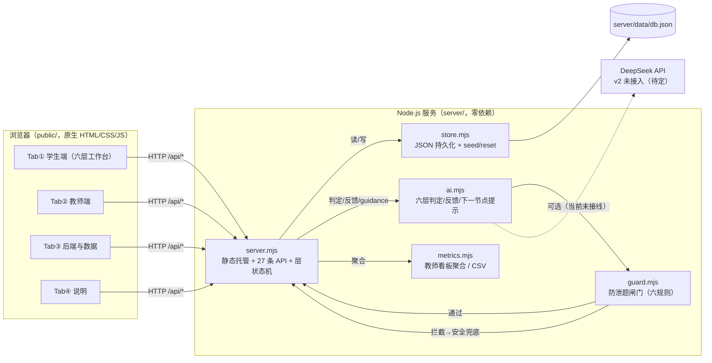
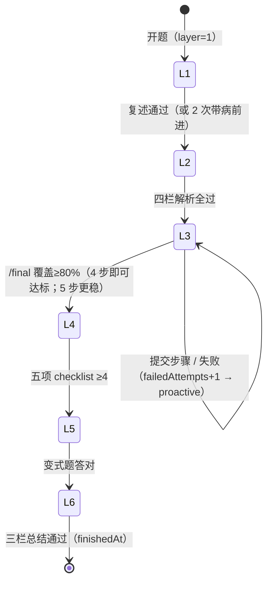
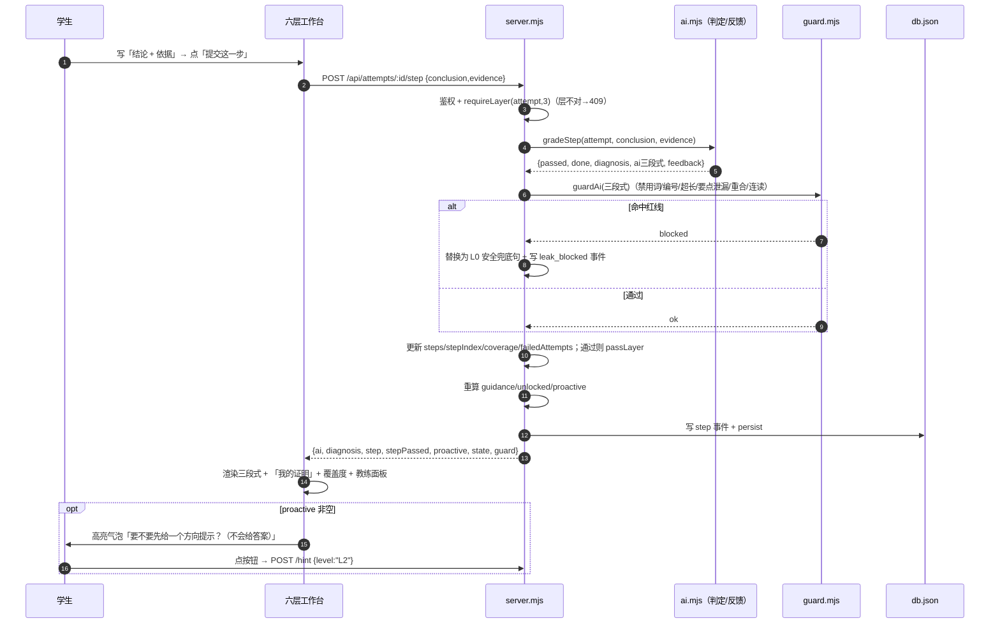

# 前后端 Demo · 技术架构说明（v2 六层版）

> 版本 v2.1 ｜ 日期 2026-10-31 ｜ 作者：产品设计（product-designer）｜ 阅读对象：技术评审、答辩老师、后续接手开发
> 依据：`SIX_LAYER_V2_CONTRACT.md`（v2 契约）与已落地实现。**实测**：`node tests/e2e.mjs` **111/111 PASS**；`server/server.mjs` 共 **27 条路由**、约 44KB；前端 QA 截图见 `../_qa-v2/shots/`。
> 目标：讲清四件事——v2 架构长什么样、一次「提交本层」发生了什么、红线在哪一层被执行、数据怎么存。

---

## 0. 一页纸（白话版）

- **v2 的主流程是六层**：① 前置知识点 → ② 题目解析 → ③ 详细步骤 → ④ 完整讲解 → ⑤ 同类题 → ⑥ 总结。每层一个提交端点，后端判定通过后把 `state.layer` 推进到下一层；**没过的层调用下一步端点会 409**（「当前在第 N 层」）。
- **前端只展示，后端做判定**：层状态、提示预算、解锁、proactive 主动提示、覆盖度、掌握度全部由后端算，前端只渲染 `state`。
- **AI 教练**是前端面板（右侧），数据来自后端 `guidance/proactive/feedback`；v2 AI 为 **mock 规则引擎**（判定 + 预置反馈），没有真实模型调用。
- **红线五层不变**：题目白名单 → 生成约束 → guard 闸门 → 接口规则（层门禁/预算）→ 前端展示；第 4 层「完整讲解」由学生讲，AI 只给五项 checklist，**没有标准讲解**。
- **一句话架构**：**浏览器（六层工作台）→ Node API（27 路由/层状态机/判定/闸门）→ JSON 存储（36 生/12 题/60 attempt）**。

| 白话词 | 解释 |
|---|---|
| 六层 / stepper | 学生看到的六个学习步骤；顶部步骤条显示进度与锁定状态。 |
| layerStatus | 六层状态包：哪层 active / done / locked，由后端返回。 |
| guidance | 本层任务卡配置：标题、指令、输入占位、提交按钮文案。 |
| 判定 | 后端按规则判断本层提交是否通过（如四栏是否填全、讲解五项是否到位）。 |
| proactive | 连续失败 2 次时后端主动返回的「要不要给方向提示」气泡。 |
| guard | 后端里检查 AI 输出有没有泄题的一段代码（六条规则）。 |
| state | 后端返回的「当前进度包」，前端不自己推算。 |

---

## 1. 架构图



**关键约束**：前端不实现层状态/预算/解锁逻辑，只渲染 `state.layer/layerStatus/budgets/used/unlocked`；刷新页面通过 `GET /api/attempts/:id` 恢复六层记录。

---

## 2. 技术选型与零依赖约束

| 项 | 选择 | 原因 |
|---|---|---|
| 运行时 | Node.js 18+（本机实测 24.19） | 学校电脑/答辩机普遍可装；内置模块足够 |
| 后端框架 | 无（`node:http`） | 零 `npm install`，拷贝即跑，断网可用 |
| 前端框架 | 无（原生 JS + hash 路由） | 避免构建步骤 |
| 存储 | JSON 文件（临时文件 + rename 原子写；事件上限 4000） | 演示规模足够；可删可重置 |
| AI | mock 规则引擎（v2）；真实模型未接线 | 演示稳定、离线可用；真实模型见第 8 节待实现 |
| 测试 | `tests/e2e.mjs`（原生 fetch 断言，随机端口 + 临时 db，111 条） | 不引入测试框架 |

---

## 3. 六层状态机（v2 核心）

### 3.1 层与通过条件

| 层 | 名称 | 提交端点 | 判定规则（后端） | 通过后 |
|---|---|---|---|---|
| 1 | 前置知识点 | `POST /knowledge`（answer / request-card） | 复述含定义关键词且长度达标；累计 2 次未过 → 带病前进 `weakPoint=true` | layer=2 |
| 2 | 题目解析 | `POST /parse` | 四栏逐项检查（要证什么/几件事/关键词/知识点），全过才通过 | layer=3 |
| 3 | 详细步骤 | `POST /step`（结论+依据）、`/hint`、`/answer-request` | 每步与预设 keySteps 匹配且有依据；5 步全过后交 `/final` 覆盖 ≥80% | layer=4 |
| 4 | 完整讲解 | `POST /explain` | 学生讲稿按五项 checklist 核对（目标/结构/关键步骤/依据/结论），≥4 项通过 | layer=5 |
| 5 | 同类题 | `GET/POST /variant` | 答案含正确结论 + 理由关键词 | layer=6 |
| 6 | 总结 | `POST /summary` | 三栏≥6 字 + 关键词命中 ≥2 | finishedAt / mastery / independence，六层全 done |

### 3.2 状态迁移图



补充规则：

- **层锁**：上层未通过时，下一层端点返回 409 `WRONG_PHASE`（detail.layer/expected）；
- **步骤状态**：第 3 层每一步在「我的证明」里有 `passed / revision` 两种状态，失败步不前进（stepIndex 不变）；
- **主动提示**：第 3 层 `failedAttempts≥2` 时 `state.proactive` 非空（offer L2），写对后清空；
- **任意层**都可调用 `/xiaobai`（≤2 次）和 `/answer-request`（拒绝模板）。

### 3.3 一次「提交本层」的时序（以第 3 层为例）



其它层同理：`/knowledge`→`gradeKnowledge`、`/parse`→`gradeParse`、`/explain`→`checkExplain`、`/variant`→`gradeVariant`、`/summary`→`checkSummary`；AI 反馈文案统一过 guard（数组反馈走 `guardFeedbackArray`，字符串走 `guardedString`，三段式走 `guardAi`）。

---

## 4. 红线在后端哪一层（v2 共五层）

| 层 | 位置 | v2 做什么 | 拦什么 |
|---|---|---|---|
| L1 数据白名单 | `GET /api/problems/:id`、知识点卡 | 题目详情只回题面/章节/难度/状态等（`whitelistProblem`）；知识点卡只回定义/换说法/核对问题 | `keySteps`、`hints`、`referenceProof`、`script` 永不进响应 |
| L2 生成约束 | `ai.mjs` | 六层判定与反馈全部由固定规则生成：第 4 层只输出五项 checklist；第 6 层只输出总结卡（学生原话拼接）；无「标准讲解」生成路径 | 生成阶段就不产出完整证明/标准讲解 |
| L3 输出闸门 | `guard.mjs` | 六条规则：BANNED_WORD / NUMBERED_STEPS / TOO_LONG / STEP_LEAK / REFERENCE_OVERLAP / CHAINED；覆盖三段式、提示、拒绝、小白解释、四栏反馈、五项 checklist、总结卡 | 命中即替换 `SAFE_TEXT`，写 `leak_blocked`，后端面板计数 |
| L4 接口规则 | `server.mjs` | 层门禁（409）、提示预算/解锁（409/429）、小白次数（429）、旧 `/review` 停用（409）、粘贴标记 | 不允许跳层、不允许超预算、不允许旧复盘接口绕过 |
| L5 前端展示 | `public/` | 只渲染后端返回内容；AI 教练面板固定「现在请你做」；第 4 层固定显示「完整讲解由你完成，AI 只核对，不提供标准讲解」；无「参考证明/标准讲解」入口 | 前端即使被改，也拿不到数据（L1）且规则仍在后端（L3/L4） |

> 一句话：**L4 保证「不能跳层乱来」，L3 保证「给了也不泄」，L1 保证「根本拿不到」，L2 保证「没有标准讲解这个生成物」**。

---

## 5. 数据模型摘要（db.json，v2）

```text
meta        version="2.0.0" / seededAt / mode / inviteCode / demoStudent / classInfo
students    36 人：id / sid / name / className / group / lastActive
problems    12 道：题干 / 章节 / 知识点 / 难度 / 必做或选练 / status(published|review)
            knowledge{question, professional, plain, checkQuestion, plainRestatement, keywords}
            keySteps[≤5]（内部，含 question/match）/ hints(L1–L4) / referenceProof（仅内部）/ variant
attempts    六层作答：layer / layerLabel / layerStatus{1..6} / guidance
            knowledge{requested,question,professional,plain,attempts,answer,passed,feedback,weakPoint}
            parse{goal,parts,keywords,tools,plainRestatement,feedback[],passed}
            steps[{no,conclusion,evidence,status,feedback}] / stepIndex / failedAttempts
            budgets/used{L0–L4,xiaobai,refusals} / unlocked
            coverage{items,covered,total,percent,passed} / explanation{text,feedback,passed}
            variant{title,stem,answer,result} / summary{knowledge,difficulty,steps,feedback,card,passed}
            mastery / independence / finishedAt / startedAt / pasteFlags / timeMin / chat / hintLog / stuckPoints
events      流水账：login / attempt_start / knowledge_card / knowledge / parse / step / paste / hint /
            answer_request / xiaobai / final / explain / variant / summary / finish / leak_blocked / reset
```

| 数据 | 写入时机 | 谁读 |
|---|---|---|
| `attempts.layer/layerStatus/guidance` | 每次层提交通过（passLayer） | 前端 stepper、任务卡、AI 教练 |
| `attempts.steps/stepIndex/coverage` | 第 3 层每次 step/final | 「我的证明」、覆盖度、完成判定 |
| `attempts.used/unlocked/failedAttempts` | 每次提示/失败 | 提示按钮、proactive、独立性判定 |
| `attempts.summary/mastery/independence/finishedAt` | 第 6 层通过 | 完成页、教师端、CSV |
| `events` | 每次操作 | 后端面板事件流、教师看板聚合 |
| `problems.knowledge/keySteps/referenceProof` | seed/教研录入 | 判定与 guard 内部；`referenceProof` 永不外发 |

> 关系：1 个学生 → 多条 attempt；1 道题 → 多条 attempt；1 条 attempt → 多条 event。教师端仍由 attempts + events 聚合，**演示学生 s-demo 不计入班级统计**。

---

## 6. v1 兼容与迁移

| v1 概念 | v2 状态 | 说明 |
|---|---|---|
| 10 节点脚本 / P1–P6 阶段条 | **已移除** | ai.mjs 中旧 `SCRIPT` 已删；页面由六层 stepper 取代；P1–P6 仅作内部 phase 字段保留（`phase = P + min(6, layer)`） |
| `POST /step {text}` | 兼容 | `text` 会当作 `conclusion`；v2 前端用 `{conclusion,evidence}` |
| `POST /final` 覆盖表 | 保留 | 改为第 3 层收口 → 第 4 层 |
| `POST /review` 五问复盘 | **停用** | 任意请求 409；总结改由 `/summary`（第 6 层）完成 |
| 教师看板 / CSV / 事件 / 运维 | 保留 | 口径与 v1 完全一致（72%/4.8/38-34-28/32-27-19-13-9） |
| 提示预算 / 软着陆 / 拒绝 / 小白解释 | 保留 | 位置更好找（常驻在 AI 教练面板） |

> 兼容策略：**学生侧流程不兼容 v1（六层替代十节点），接口层保留旧字段与旧端点兜底**（/review 明确 409 避免误用）。

---

## 7. 部署、扩展与已知限制

**运行**：Windows 双击 `start-demo.cmd`；或 `node server/server.mjs`。环境变量：`PORT`（默认 8787）、`DB_PATH`（默认 `server/data/db.json`）、`DEEPSEEK_API_KEY`（当前只影响 health.mode，见限制）。

**测试**：`node tests/e2e.mjs` 起随机端口 + 临时 db，111 条断言覆盖：v2 元信息、六层逐步通过、层门禁 409、proactive、提示预算/软着陆、拒绝、小白上限、知识卡白名单、教师看板/CSV/事件/reset、guard 六规则。

**扩展路径**：

1. 真实模型：在 ai.mjs 判定后、guard 前接入 DeepSeek（沿用 v1 的 `tryDeepSeek`），输出仍先过 guard；
2. 存储：JSON → SQLite/Postgres（store.mjs 替换，字段结构不变）；
3. 鉴权：演示 token → 微信登录 + 班级服务；
4. 题库：12 题 → 50 题 + 审核状态机（见 `../../03-产品设计/05-教师端与数据闭环.md`）；
5. 观测：guard 命中率、proactive 触发率、每层通过率进质量看板。

**已知限制**：

- v2 AI 为 mock 规则引擎，**真实模型未接线**；`DEEPSEEK_API_KEY` 只改 `/api/health.mode` 显示值；
- 单进程 / JSON 文件存储，不适合并发多实例；事件上限 4000 条；
- token 存内存，服务重启需重新登录；
- 教师端接口演示版不强制鉴权；
- v2 允许所有已发布题进入六层流程（判定基于各题 keySteps/knowledge），不再只开放第 2 题。

---

## 8. 与实现的核对结果

### 8.1 已核对（后端 v2：`node tests/e2e.mjs` 111/111 PASS）

1. 27 条路由（含 7 条六层端点）与 `/api/admin/routes` 一致；
2. `health.v2/version=2.0.0`、`meta.layers` 六层顺序正确；
3. `stateOf` 返回完整六层字段，e2e 逐字段断言；
4. `initAttemptFields/passLayer/requireLayer` 实现层状态机与 409 门禁；
5. `gradeKnowledge/gradeParse/gradeStep/checkExplain/gradeVariant/checkSummary` 与契约判定口径一致（含带病前进、五项 ≥4、三栏+关键词）；
6. `buildProactive` 仅第 3 层且 `failedAttempts≥2` 触发，写对后清空；
7. guard 覆盖三段式（`guardAi`）、反馈数组（`guardFeedbackArray`）、字符串（`guardedString`）；
8. 教师看板/CSV/事件/reset 与 v1 一致（回归断言）。

### 8.2 已核对（前端 v2，QA 截图）

- `_qa-v2/shots/` 含 layer1 / layer3 / proactive / refusal / layer3-done / layer4 / layer6-done / 390 截图；对应验收：六层 stepper、提交入口、AI 教练、主动 offer、拒绝、完成页、窄屏。

### 8.3 待核对 / 已知偏差

| # | 项 | 说明 |
|---|---|---|
| 1 | 真实模型未接线 | 与 API_CONTRACT/README 的「可选 DeepSeek」文案不一致，答辩前需接回或改文案（待 Lead 定） |
| 2 | `/api/problems/:id` 不再返回 `hasScript` | v2 用 `available = status==='published'`；旧调用方需适配 |
| 3 | v1 文档中的 10 节点路径 | 已不适用；旧材料引用需改口径（六层 = P1–P6 的教学顺序） |
| 4 | 每层通过阈值 | 第 3 层允许 4/5 步即覆盖 80% 进第 4 层，与「5 步全写」不同，演示时按 4 步即可 |

---

## 9. 引用

- `SIX_LAYER_V2_CONTRACT.md`（v2 唯一事实源：六层定义、state、API、验收）
- `API_CONTRACT.md`（v1 基础约定与实现偏差记录）
- `API.md`（27 端点与示例）
- `DEMO_SCRIPT.md`（v2 演示脚本）
- `../README.md`（启动、四 Tab、口径）
- `../../03-产品设计/07-六层引导工作台规格.md`（六层产品规格）
- `../../03-产品设计/04-AI引导与提示阶梯规格.md`（L0–L4 与红线）
